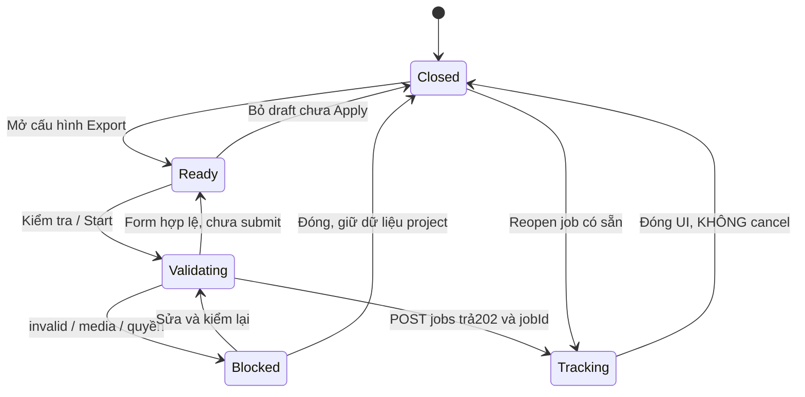
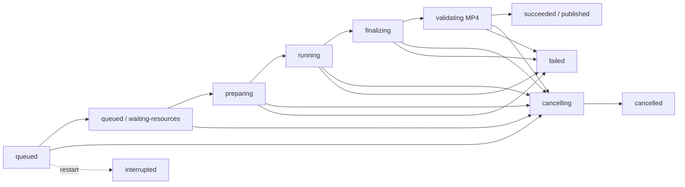

# UI-04 — Export Workspace Specification v1.0

**Dự án:** AI Music Video Studio — Hòa Âm  
**Trạng thái:** Approved for Design — Not Implemented  
**Loại giao diện:** Modal Export Dialog  
**Phong cách:** Minimal Professional — Design System v1.0

## 1. Mục tiêu

Xây dựng một giao diện xuất video MP4 chuyên nghiệp, tối giản, dễ hiểu, bảo đảm người dùng có thể cấu hình, khởi tạo, giám sát, hủy và nhận kết quả xuất video.

Export không được làm gián đoạn dữ liệu project, làm mất phiên chỉnh sửa hoặc thay đổi trạng thái lưu một cách sai lệch.

## 2. Bố cục đã phê duyệt

Sử dụng dialog lớn, chia hai cột.

### Header

- Tiêu đề: “Xuất video”.
- Mô tả ngắn về project đang xuất.
- Nút đóng dialog.
- Không bo góc.

### Cột trái — Preview & Validation

- Video Preview lấy từ composition hiện tại.
- Hiển thị tỷ lệ khung hình.
- Thông tin project/video.
- Trạng thái media.
- Cảnh báo file thiếu hoặc cấu hình không hợp lệ.
- Trạng thái kiểm tra tài nguyên thực tế nếu backend hỗ trợ.

### Cột phải — Export Configuration

- Tên file MP4.
- Độ phân giải.
- FPS.
- Tỷ lệ khung hình.
- Video preset thực tế.
- Chọn thư mục xuất bằng native folder picker.
- Tóm tắt thông số xuất.

Không bổ sung codec, bitrate, quality presets hoặc các lựa chọn mà renderer chưa hỗ trợ.

### Footer

- Hủy/Đóng.
- Bắt đầu xuất video.
- Hiển thị trạng thái invalid, busy hoặc queued với lý do cụ thể.

## 3. Các trạng thái Export

Phải phân biệt rõ:

1. Ready — sẵn sàng cấu hình.
2. Validating — đang kiểm tra dữ liệu.
3. Blocked — chưa đủ điều kiện xuất.
4. Queued — tác vụ đã được tiếp nhận.
5. Waiting — đang chờ tài nguyên.
6. Rendering — đang xử lý video.
7. Cancelling — đã yêu cầu hủy, chờ kết quả.
8. Cancelled — đã hủy thực sự.
9. Failed — xuất thất bại.
10. Succeeded — MP4 đã hoàn tất và được backend xác minh.

Không hiển thị “Xuất thành công” khi job chỉ mới được đưa vào hàng đợi.

## 4. Background Render

Đóng dialog không được hủy render.

- Render job thuộc application controller/job service, không thuộc vòng đời component dialog.
- Khi đóng dialog, Editor vẫn giữ nguyên project, selection, playhead, draft và editor lease.
- Job đang chạy xuất hiện trong thanh trạng thái hoặc khu vực hoạt động.
- Người dùng có thể mở lại dialog để xem tiến trình.
- Có thể tiếp tục thao tác Editor theo quyền chỉnh sửa hiện hành.
- Các chỉnh sửa sau thời điểm bắt đầu render không làm thay đổi snapshot của job đã khởi tạo.
- Chuyển sang Dashboard không được tự động hủy job.
- Nút “Hủy render” là hành động riêng, có xác nhận trạng thái từ backend.

Việc tiếp tục render áp dụng khi đóng dialog hoặc chuyển workspace trong cùng phiên ứng dụng. Không mặc định cam kết job sống qua việc tắt launcher hoặc hệ điều hành nếu backend chưa bảo đảm.

## 5. Project Snapshot & Revision

Tuân thủ các hợp đồng hiện có:

- Export dựa trên snapshot/revision hợp lệ.
- Không render từ state chưa được đồng bộ hoặc không xác định revision.
- Job phải dùng snapshot bất biến đã được pin.
- Không bỏ qua editor lease hoặc optimistic concurrency.
- Không tự ghi đè bản chỉnh sửa từ phiên khác.
- Thay đổi preset đi qua controller/history hiện có.
- Thay đổi preset phải phản ánh đúng dirty state và Preview.
- Hủy dialog trước khi áp dụng preset không làm project dirty.
- Nếu đã áp dụng preset vào project thì phải giữ đúng trạng thái thay đổi, kể cả khi người dùng không tiếp tục xuất.
- Chỉnh sửa project sau khi tạo job không được thay đổi đầu ra của job đó.

Codex phải đối chiếu UX của cấu hình tạm trong dialog với giới hạn của domain hiện tại trước khi triển khai.

## 6. Output Folder

- Chỉ chọn thư mục bằng native picker được backend cung cấp.
- Sử dụng opaque folder grant theo contract hiện có.
- Hủy picker không được hiển thị như lỗi xuất video.
- Không gửi absolute filesystem path tùy ý từ frontend.
- Kiểm tra grant không hợp lệ/hết hạn trước khi xử lý.
- Không tự xuất file vào thư mục khác khi chưa được người dùng cho phép.

## 7. Validation & Errors

Các lỗi phải có thông báo tiếng Việt và hướng xử lý:

- Project hoặc revision không còn hợp lệ.
- File media bị thiếu.
- Không có quyền ghi.
- Thư mục xuất không hợp lệ.
- Không đủ tài nguyên theo kết quả kiểm tra thực tế.
- Job đang chờ tài nguyên.
- Backend mất kết nối.
- Renderer thất bại.
- Người dùng yêu cầu hủy.
- Output MP4 không đạt validation.

Không giả lập trạng thái “đủ RAM”, dung lượng MP4 ước tính hoặc phần trăm render nếu backend chưa có dữ liệu đáng tin cậy.

## 8. Kết quả xuất video

Khi job thành công, hiển thị:

- Tên file MP4.
- Thông số xuất thực tế.
- Trạng thái hoàn thành.
- Đường dẫn hoặc nhãn vị trí lưu theo thông tin được phép hiển thị.
- Nút mở video nếu API/launcher hỗ trợ.
- Nút mở thư mục nếu API hỗ trợ.
- Nút thử xuất lại.

Thử lại phải tạo job mới theo contract, không làm thay đổi kết quả đã xuất thành công trước đó.

## 9. Design System

Tuân thủ:

- Dark Slate / Charcoal.
- Muted Lavender accent.
- `border-radius: 0`.
- Panel phẳng, đường viền mảnh.
- Segoe UI.
- Body 14px, label 13px, caption 12px.
- Keyboard navigation.
- Dialog focus trap và return focus.
- Escape đóng dialog nhưng không hủy render.
- Loading, invalid, disabled, error và success phải dễ phân biệt.
- Responsive cho các desktop viewport đã thống nhất.

Dialog cần có header/footer cố định; nếu nội dung dài, chỉ cuộn body của dialog.

## 10. Những chức năng không thuộc phạm vi tự động triển khai

- Thay codec/encoder mặc định.
- Tùy chỉnh bitrate chưa được backend hỗ trợ.
- Render cloud.
- Upload MP4 tự động lên Drive.
- Hệ thống preset mới chưa có trong domain.
- Thay đổi project schema để thêm export settings.
- Tạo renderer hoặc API giả để khớp mockup.

Các capability mới chỉ được đề xuất thành task riêng.

## 11. Acceptance Criteria

| ID | Tiêu chí |
|---|---|
| UI-EX-01 | Export mở bằng dialog hai cột |
| UI-EX-02 | Đúng Minimal Professional và Design System |
| UI-EX-03 | Chỉ hiển thị cấu hình export thực sự hỗ trợ |
| UI-EX-04 | Preview và MP4 dùng đúng composition/preset |
| UI-EX-05 | Preset thay đổi qua domain/history và dirty state chính xác |
| UI-EX-06 | Folder picker cấp grant đúng, cancel không gây lỗi giả |
| UI-EX-07 | Job dùng đúng snapshot/revision |
| UI-EX-08 | Đóng dialog không hủy render |
| UI-EX-09 | Tiến trình và trạng thái phản ánh backend thật |
| UI-EX-10 | Hủy render có trạng thái terminal đúng |
| UI-EX-11 | Failed, cancelled, succeeded được phân biệt rõ |
| UI-EX-12 | MP4 hoàn tất có thể truy cập bằng action được hỗ trợ |
| UI-EX-13 | Không làm mất project/draft/lease/history |
| UI-EX-14 | Keyboard, focus, Escape và overflow hoạt động đúng |
| UI-EX-15 | Browser và backend regression đạt theo phạm vi thay đổi |

## 12. Kế hoạch triển khai

- R1: Sử dụng Dialog, Field, Button và Status primitives đã duyệt.
- R3: Đặt Export entry trong Editor Header và background job status.
- R5: Triển khai Export Dialog trên controller/API hiện có.
- R6: Browser E2E, regression, snapshot correctness và UX acceptance.

**Quyết định thiết kế được phê duyệt không đồng nghĩa đã phê duyệt thay đổi API, renderer hoặc project schema.**

**Trạng thái:** Approved for Design — Not Implemented.
---

# Phụ lục kỹ thuật — Capability và kế hoạch triển khai UI-04

**Ngày khảo sát:** 24/11/2026 (Asia/Saigon). **Baseline:** `dev`, HEAD `dc315d0`; application Export kế thừa `d12015a`. Working tree có thay đổi Markdown ghi nhận ST-01…ST-07 từ lượt trước, được giữ nguyên. Đặc tả PO phía trên được lưu nguyên văn. Phụ lục không thay hai quyết định bắt buộc hoặc15 acceptance criteria.

**Approved:** dialog hai cột/góc vuông/Minimal Professional, đóng dialog không hủy render. **Proposed:** chi tiết wireframe, component và các phương án kỹ thuật chưa được PO chốt. “Implemented” dưới đây là code path tìm thấy, không phải test đã pass trong lượt này. Không sửa code/API/schema/renderer, không chạy render/browser mới hoặc dùng media người dùng.

## A. Nguồn, phiên bản, minh họa

Đã đối chiếu [AGENTS](../../AGENTS.md), [Design System](DESIGN_SYSTEM.md), [UI-02](UI_02_VIDEO_EDITOR.md), [UI-03](UI_03_STORAGE_MANAGER.md), [Gap Analysis](UI_GAP_ANALYSIS.md), [Plan](UI_REDESIGN_PLAN.md), [MVP contracts](../architecture/MVP_CONTRACTS.md). PRD/SRS/RTM/OPEN_QUESTIONS ở root. UI-02 nguyên văn giữ nguyên; UI-03 Approved for Design theo ST-01…ST-07 không đồng nghĩa transfer backend đã đủ.

Phiên bản manifests: Next 16.4.6, React 19.3.1, Tailwind 4.3.5, Remotion 4.0.545; worker cùng Remotion 4.0.545. Frontend đọc: `studio.tsx`, `inspector.tsx`, `hooks/use-studio.ts`, `lib/{api,editor-lease}.ts`; domain `src/{index,lyrics}.ts`, project/job schemas; shared composition `scene.tsx`; worker `root.tsx/render.mjs`; backend `app.py`, `jobs.py`, `store.py`, `source_gc.py`; tests ở §J.

Hai ảnh PO gửi là **tham chiếu thiết kế**, không bằng chứng runtime:

- UI-03 có workspace riêng/bốn tab; folder CreateVideoMusic và “Đã kết nối” là trạng thái mẫu. Production lấy backend; badge tròn trong ảnh không thay DS radius0. Task history không được giả lập và phải tách snapshot list.
- UI-04 có dialog hai cột/preview-validation/config/footer. Icon “Video Preview” chỉ là placeholder ảnh, không đáp ứng Preview composition thật. Check xanh chỉ sau kiểm thực; tên “Video của tôi.mp4” không chứng minh backend hỗ trợ custom filename.
- Ảnh chưa chép binary vào repo. Không cần ảnh để đọc wireframe bên dưới; không viết UI/renderer giả cho giống hình.

## B. Capability matrix

**Implemented**: có code; **Partially supported**: có nền nhưng thiếu UX/contract; **Missing**: chưa tìm thấy; **Requires verification**: cần kiểm thực khi triển khai. Đọc tests không được xem là đã chạy.

| Capability | Phân loại | Evidence / giới hạn |
|---|---|---|
| Presets | Implemented; runtime Requires verification | `packages/domain/src/lyrics.ts:153`:12 tuples, schema/cross-field kiểm kích thước/FPS; không24FPS/4K |
| Project preset/history/dirty | Implemented trong Editor; dialog staging Missing | `studio.tsx` preset callback gọi change, scale x/y/fontSize; history/hash trong useStudio. Không clone scaling khác trong Export |
| Preview/export parity | Implemented shared model; UI-04 Requires verification | Player và worker root cùng ProjectScene/preset/duration, khác asset URL adapter. Chưa có ExportPreview component |
| Native folder grant | Implemented; cancel UX Partially supported | POST folder-grants scope export trả id/label/scope hoặc cancelled:true; choose() hiện ném error khi user hủy |
| Create/revision | Implemented | render() sync working snapshot rồi POST jobs với projectId/revision/grantId; API revision-check/template validation, trả202 |
| Lease tại job create | Partially supported; race Requires verification | Frontend có authority/writable guards. POST jobs baseline **không gọi leases.guard**, chỉ revision-check. Không quảng cáo server đã fence mọi stale lease render; cần review nếu siết policy |
| Immutable snapshot/pins | Implemented; full race Requires verification | Jobs.start deep-copy project + snapshotHash, SQLite job; sourceGC giữ assetRefs từ jobs; worker hash/copy media vào owned folder. Source revision không có field riêng trong job |
| Poll/progress | Implemented; ownership Partially supported | GET jobs/list/id, hook poll1s; callback gắn project authority epoch. Chỉ một job state, adopt project đổi job; cần job controller theo jobId độc lập dialog/active project |
| Cancel/output | Implemented; modal UX Missing | POST cancel→cancelling→terminal, owned-tree/staged publish; GET output succeeded/render, open-folder Windows; revoke grant có thể cancel jobs |
| Background/reopen | Partially supported | Backend ngoài view, jobs persist; chưa có dialog. Active rows đổi interrupted sau restart, không resume qua launcher/OS stop |
| Tên file MP4 tùy chọn | Missing | Output hiện `{projectId}-{jobId}.mp4`; API không nhận filename. Không input giả hoặc tự bỏ yêu cầu, cần capability review |
| Safe result summary | Partially supported | Public job có projectId/hash/status/phase/progress, không preset/source revision/filename/location đầy đủ; Job frontend type còn hẹp. Không dùng presetC để mô tả outputB |
| RAM/disk preflight | Partially supported | Jobs kiểm RAM thật/disk nội bộ; **Missing** read-only preflight API trước create. resourceSampledPass là hậu kiểm, không bảo đảm RAM hiện tại |
| Invalid/missing media | Implemented; dialog display Missing | media-status trả missing IDs; Jobs.start validate visual+audio, TPL-02≥2ảnh, TPL-03 reviewed/applied; worker hash lại |
| Error detail/retry | Partially supported | ApiError giữ code/status; asynchronous fail message generic; retry hiện render project hiện tại, chưa chốt retryB/C |
| Dialog/focus/overflow | Missing; Requires verification | Chưa Export modal/form draft/focus trap/return focus/reopen entry |

### B1. Presets thực tế

Tổng12 tổ hợp: sáu dimensions sau × FPS30/60. Form resolution/ratio/FPS phải map về một tuple hợp lệ.

| Ratio | Mức720 | Mức1080 | FPS |
|---|---|---|---|
|9:16|720×1280|1080×1920|30/60|
|16:9|1280×720|1920×1080|30/60|
|1:1|720×720|1080×1080|30/60|

Label có width×height/ratio, không chỉ “1080p” giấu portrait/square. H.264/AAC/yuv420p/concurrency1 là worker config, không dropdown codec/bitrate/quality mới.

## C. Wireframe — Proposed số đo, Approved cấu trúc

Dialog max-width đề xuất1000px, width min(1000px, viewport−32px), max-height viewport−32px; header/footer min64px; body min-height0/overflow:auto, cột minmax(0,1fr)/minmax(320px,1fr), gap/padding16. 1366×768 có max-height736, body tối đa608 trước borders;1920×1080 giữ max-width để dễ đọc. Đây là budget, chưa browser evidence. Dialog 640px trong DS trước là generic Proposed, không ép Export hai cột vào640px.

```text
┌ Xuất video · <project name thật>                        [Đóng ×] ┐
│ Source context, ratio, duration, snapshot/current label          │
├──────────────────────────────┬─────────────────────────────────┤
│ REAL COMPOSITION PREVIEW     │ Tên MP4 [capability pending]*    │
│ contain 9:16 /16:9 /1:1       │ Resolution/FPS/Ratio → tuple     │
│ play/pause, không autoplay   │ Preset summary                    │
│ <size/FPS/duration thật>     │ [Áp dụng vào project]**           │
│                             │ Folder [nhãn grant][Chọn…]        │
│ VALIDATION                  │                                  │
│ Media/schema/revision       │ Khi có job: phase/message         │
│ Chưa kiểm / errors / OK thật │ [Hủy render] riêng                │
├──────────────────────────────┴─────────────────────────────────┤
│ Blocked/waiting reason                  [Đóng] [Bắt đầu xuất]    │
└────────────────────────────────────────────────────────────────┘
 * Không bật input giả trước khi filename capability được duyệt.
** Draft khác project phải Apply rõ, không override export ẩn.
```

Ready: “Đóng/Hủy cấu hình” chỉ bỏ draft chưa apply. Active: “Đóng” khác “Hủy render”. Succeeded: thông số/output thật, “Xuất lại” theo policy. Below desktop/zoom lớn: body reflow giữ focus/close/footer truy cập được, không tự thay quyết định hai cột ở hai desktop viewports; compact ngoài phạm vi còn review.

### C1. Component hierarchy / ownership

```text
Studio / application controller (mount ổn định)
├── useStudio + EditorLease + History/record.revision (hiện có)
├── RenderJobController / useRenderJobs (proposed, keyed jobId/projectId)
│   ├── poll/rehydrate /jobs + /jobs/{id}, job generation fencing
│   ├── create/cancel/output, immutable summaryB
│   └── BackgroundJobStatus (Editor Header + Dashboard activity)
├── ExportEntry / ReopenExportAction
└── ExportDialog (visibility/draft, KHÔNG render lifecycle)
    ├── ExportDialogHeader
    ├── ExportPreviewPane (ProjectScene + source context)
    ├── ExportValidationPanel / InlineError
    ├── ExportConfigurationForm
    │   ├── PresetFields + ApplyPresetAction
    │   ├── OutputFilenameField (pending capability)
    │   └── OutputFolderField (grant + safe label)
    ├── ExportJobDetails / ExportResultActions
    └── ExportDialogFooter (Close / Start / CancelRender riêng)
```

Tên/path là đề xuất, chưa tạo module. Dùng DS Dialog/Field/Button/Status/Progress, không library mới. Visibility/draft là view state; project/history/lease/job/grant đã gắn job sống ngoài dialog. Không đổi Api editorUUID/reset project khi mount. Lyrics draft local hiện có phải giữ qua navigation, không remount LyricsPanel để hiển thị Export.

## D. State machine dialog và render job độc lập

### D1. Dialog/configuration



Closed/Ready/Validating/Blocked là UI states, không thêm job enum. Tracking hiển thị lifecycle backend. Job có thể terminal khi dialog Closed; reopen không tự POST job mới/apply preset. Read-only vẫn xem job theo API policy, edit/create phải tôn trọng authority.

### D2. Job lifecycle → nhãn UI-04

| Backend thực | Nhãn UX | Quy tắc |
|---|---|---|
| Chưa job, form hợp lệ | Ready | Không cam kết resource admitted |
| Pre-submit validation | Validating | Khác phase validating cuối render |
| Invalid/missing/lease/grant lỗi trước create | Blocked | Reason persistent, không fake job |
| queued/queued | Queued |202 accepted, chưa heavy process |
| queued/waiting-resources | Waiting | Message RAM backend thật |
| preparing/running/finalizing/validating | Rendering + phase cụ thể | Cuối pipeline ghi “Đang kiểm tra MP4”, không quay form validation |
| cancelling, dù phase còn queued/running | Cancelling | Ưu tiên status; cancel ack không là Cancelled |
| cancelled | Cancelled | Terminal thật, không output link |
| failed | Failed | Reason safe, retry attempt mới |
| succeeded | Succeeded | Chỉ sau validate/publish; mới mở output |
| interrupted | “Bị gián đoạn — cần xuất lại” | Restart nonterminal; giữ riêng, không ép Cancelled/Success |



Diagram rút gọn: lỗi có thể ở admission/preparation/publish; mọi phase active phải xử lý stop/restart theo backend, không chỉ queued. Cancel-vs-publish đọc terminal thật: job đã succeeded không đổi thành cancelled theo click UI.

Worker progress đo đến0.85; finalizing0.88/validating0.95 là mốc phase backend;1 sau publish. UI gọi “Tiến trình tổng hợp”, không suy ETA/byte progress tuyến tính. Không timer fake%; resource/admission không denominator dùng text/indeterminate.

## E. Flows và invariants

### E1. Native folder

1. POST folder-grants `{scope:'export'}` qua Api/auth hiện có, mở native chooser backend.
2. `{cancelled:true}` → Ready, giữ draft/grant cũ nếu có, không lỗi xuất/POST job/project dirty.
3. `{id,label,scope}` → kiểm scope, giữ opaque grant trong session memory, hiển thị label; không persist token/grant trong project/Drive/preferences.
4. Baseline không read-only grant-preflight endpoint; `folder(id,'export')` kiểm lúc create. Invalid403 yêu cầu chọn lại, không fallback folder hoặc gửi arbitrary path.
5. Đóng dialog **không DELETE grant đã gắn job**: baseline revoke grant có thể cancel jobs. Cleanup grant lifecycle phải tách close, không bỏ backend cancel policy.

### E2. Invalid / missing media

Capture project/authority epoch; check schema/preset/lời reviewed-applied; sync đúng working snapshot khi có quyền; GET media-status đúng project sau sync. Response sai generation/project không cập nhật validation. Empty missing list trước fetch không có nghĩa verified. Endpoint kiểm working server state, không snapshotC chưa sync.

Missing/corrupt → Blocked list asset names/IDs thật + relink; không xóa clip/reimport source ngầm. Jobs.start kiểm visual+audio, MusicCard2ảnh, LyricsVideo reviewed/applied; worker hash lại. Source có thể đổi sau check nên validation không là quyền bỏ backend checks. RAM/disk worker có thể Waiting/Failed sau create; không giữ check xanh cũ để khẳng định đủ tài nguyên.

### E3. Preset draft / snapshot / revision — UX Proposed cần PO chốt

**EX-P01 đề xuất:** dialog giữ draftPreset từ12 tuples. Chọn khác project → nhãn “Chưa áp dụng”, summary draft, Start disabled tới khi Apply hoặc bỏ draft. Preview trước Apply vẫn current composition có nhãn preset đang dùng. “Áp dụng vào project” gọi **chính controller callback hiện dùng Inspector**, giữ scaling x/y/fontSize, history/remap/validation, không code duplicate khác. Một Apply một Undo transaction.

Hủy/đóng trước Apply: draft bỏ, project/hash/history không đổi. Sau Apply: dirty theo hash/Preview đúng, close không rollback hoặc manual-save tự động. Undo/Redo đang mở dialog phải reconcile draft/summary và giữ IME, không ghi stale field ngược project.

Start: authority+projectID → grant hợp lệ → assert quyền hiện hành → Apply xong → sync(snapshotB) serialized/expected revision → POST jobs đúng revision trả về → backend deep copy/hashB → track jobId. EditC sau create không đổi B/output; render success không đổi manualSavedHash hoặc clear dirtyC. C phát sinh giữa sync/POST gây409 thì giữ C, hỏi/hiển thị rõ snapshot retry theo policy, không force PATCHB bằng revision mới.

Job public không trả full snapshot/source revision/preset. SummaryB clone trong controller đủ cùng phiên nhưng không đủ sau reload. **EX-P03** cần safe metadata contract trước hứa summaryB sau rehydrate; không fetch private job body hoặc thêm field trái job schema. Preview trước submit phải thật. Sau create nếu hiển thị previewB thì dùng cloneB đã capture và ghi “Bản đang xuất”; không gắn liveC là B. Sau rehydrate thiếu cloneB hiển thị rõ thiếu snapshot preview, vẫn xem status/output được; UX/fetchB bổ sung cần review.

### E4. Background / reopen

Visibility không sở hữu job lifecycle. Controller proposed giữ jobs keyed by ID; một poll scheduler mỗi active job hoặc một list scheduler đã chọn. Callback gắn job/session generation, không lệ thuộc authority epoch của current project để bỏ luôn updates. Không claim lease chỉ để theo dõi render.

Close→background summary Editor Header; Dashboard có activity entry khi chuyển workspace. “Theo dõi” mở đúng jobId, không POST mới. JobB chạy khi current projectC phải có nhãn source, không auto-openB/discard draftC. Dialog unmount chỉ dọn focus/listeners view, không duplicate/clear poll của service. Mất writable vì takeover vẫn theo dõi job, còn edit/create không được bật lại. API restart401 cần bootstrap theo policy; restart launcher nonterminal interrupted, không hứa resume.

Network mất ngay sau create: kết quả accepted có thể chưa biết; khóa submit trùng và reconcile GET jobs trước retry. Baseline chưa idempotency key; không hứa exactly-once hoặc tự POST liên tục.

## F. Keyboard / focus / accessibility

Dùng DS đã duyệt: Segoe UI, body14/label13/caption12, góc vuông, border-control/focus-visible khác selected. Modal labelledby title, background inert, Tab/Shift+Tab trap; initial focus title nếu nội dung dài hoặc field hợp lý. Close/Escape trả focus ExportEntry hoặc activity trigger còn tồn tại. Header/footer cố định, body scroll, focused control không bị footer che; không positive tabindex.

Order đề xuất: close → Preview controls → validation links → config → picker/apply → footer. Escape đóng UI **không cancel render**; cancel là action riêng với pending/terminal. Escape trong native picker xử lý chooser trước, không biến picker cancel thành cancel job. Submit invalid focus error summary/field, reason ngoài disabled Start đọc được. Không chiếm Ctrl+Z native khi nhập text; không aria-live mỗi frame/poll unchanged. Progress announce theo phase, lỗi mới cần chú ý có alert; reduced motion chỉ shell, không đổi video content.

Cần kiểm NVDA/Chromium/IME, font fallback/dấu Việt/file dài, zoom/body overflow và hai viewport. Số đo/ratio tài liệu không thay browser accessibility test; chưa chạy ở lượt này.

## G. Error-state matrix

| Tình huống | Nguồn | UX/action | Không được làm |
|---|---|---|---|
| Picker cancel | cancelled:true | Ready, giữ draft, chọn lại | Failed giả |
| Invalid/expired grant |403 | Blocked, chọn lại folder | Raw path/fallback folder |
| Mất quyền | R0/409 sync-mutation | Chặn apply/create, giữ draft, vẫn xem job | Writable do open/close dialog |
| Stale revision |409 POST/PATCH | Giữ C, reconcile/retry explicit | Last-write-wins |
| Missing/corrupt | media-status/hash validation | Blocked hoặc Failed thật, relink | Check xanh trước response/xóa source |
| Template/lyrics | RENDER_INPUT422 | Message thêm media/duyệt/applied lời | Auto approve lyrics |
| Queue đầy | RENDER_INPUT422 | Blocked/thử sau | Queued khi không jobId |
| RAM waiting | phase waiting-resources | Waiting/message/cancel | Fake đủRAM/ETA |
| Disk thiếu | Worker generic fail hoặc507 tại API phù hợp | Message safe thật, detail cần EX-P04 | Tự bịa dung lượng/đọc private logs |
| Network/401 | fetch error/session | Last-known + stale indicator, retry/bootstrap đúng policy | Job Failed/Cancelled chỉ vì poll lỗi |
| Renderer/MP4 validation | failed/message | Failed, data giữ, retry mới | Output link trước success |
| Cancel request | cancelling | Pending, chờ terminal | Label Cancelled sớm |
| Cancel-vs-publish | terminal thật | Có thể succeeded nếu publish xong | Override terminal bằng click |
| Restart | interrupted | Bị gián đoạn, user xuất lại | Resume qua OS/launcher giả |
| Output mất sau success | GET404/error | Giữ job status thật, báo không truy cập, kiểm/thử lại | Giả download hoặc đổi path ngầm |

Async generic failure chưa đủ thông báo cụ thể UI-04§7; gap EX-P04 phải được review, không parse message regex để giả structured codes hoặc lộ absolute path/argv/failure.json.

## H. Contracts giữ nguyên / quyết định còn mở

| Boundary | Bất biến |
|---|---|
| Session/Api | Bearer+x-amvs-editor, exact-origin, token memory, cookie chỉ read media; ApiError status/code |
| Project/domain | amvs-project/1,48000ticks/s,12presets, expected revision, content/manual hash và history; không persist export draft vào schema |
| Folder | POST scope export→opaque id/label hoặc cancelled; path chỉ backend; không revoke để đóng dialog |
| Job | POST `{projectId,revision,grantId}`→202 public job; GET jobs/list/id và POST cancel; không thêm field lạ vào request hiện hữu |
| Output | GET outputs/id, POST outputs/id/open-folder; chỉ successful render, private output path không public |
| Renderer | SharedScene/time adapter/preset, immutableB và media pins, H.264/AAC, validate/publish thật; không override codec/cloud |

<a id="export-open-decisions"></a>
### H1. Quyết định kỹ thuật cần PO review

Hai quyết định thiết kế chính đã Approved, không xin duyệt lại. Các mục dưới chưa là quyền đổi contract:

| ID | Điểm cần chốt | Đề xuất / giới hạn |
|---|---|---|
| EX-P01 | Draft preset/current Preview/Apply | Flow E3: Apply rõ qua existing handler trước Start; trước Apply close không dirty, sau Apply giữ dirty |
| EX-P02 | Tên file MP4 tùy chọn thật | Task backend/API safe basename/extension/Unicode/Windows reserved/collision/no-overwrite trong grant; chưa chọn field/endpoint; chưa đủ thì không input giả/tự bỏ yêu cầu |
| EX-P03 | Safe result metadata sau reload | Minimal DTO cho actual filename/preset/source revision/location label, không full private project/path; schema compatibility trước code; hash không giả thành revision |
| EX-P04 | Resource preflight/lỗi cụ thể | Hoặc honest “Backend kiểm khi nhận job” hoặc API preflight riêng được duyệt; generic async errors cần category thật; không resourceSampledPass giả preflight |
| EX-P05 | RetryB/C và create network uncertainty | Khuyến nghị “Xuất bản hiện tại” tạo attempt mới có source summary; retryB sau reload cần snapshot capability; reconcile/idempotence policy riêng |
| EX-P06 | Server job-create authorization lease | Baseline POST jobs revision-check, không leases.guard; review nếu cần siết job permission; không tự sửa server hoặc làm yếu revision/R0 |
| EX-P07 | Width/compact/validation order |1000px, hai cột là Proposed, kiểm1366×768/1920×1080/zoom/focus, không đổi two-column/background decisions |

Không mở phạm vi project schema/renderer/codec/cloud AI/auto-upload Drive. Có thể triển khai nền tảng dùng API hiện hữu trước delta được duyệt, nhưng không gọi full UI-04 acceptance khi filename/result/errors vẫn thiếu.

## J. Regression matrix — kế hoạch, chưa chạy

Tests đã đọc, **không chạy lại ở lượt docs**: E2E `tpl01`, `multi-media`, `music-card`, `core-workflows`, `fidelity`, `long-run`; unit `lyrics/domain/editor-lease`; integration `test_local_api.py`, `test_mvp_completion.py`, launcher. Fidelity/long-run opt-in; skip/build không thay browser evidence. R0/S6 báo cáo là lịch sử riêng, không UI-04 Passed mới.

| AC | Browser evidence cần có | Backend/domain/worker và nền test |
|---|---|---|
| UI-EX-01 | Dialog2cột, header/body/footer bounds hai viewport | New Export E2E, không đổi renderer |
| UI-EX-02 | Minimal Professional/radius0/font14/13/12/hover/disabled/error | DS computed styles; theme không leak vào Scene |
| UI-EX-03 |12 tuples, không codec/bitrate giả; filename capability thật | lyrics unit presets, reject unknown request; filename tests sau EX-P02 |
| UI-EX-04 | Preview thật đúng source/current/applied ratio | Small MP4 decode dimensions/FPS/frames/time, Scene parity; tpl01/multi-media/music-card/fidelity nền |
| UI-EX-05 | Stage/cancel không dirty; Apply/Undo/Redo/Preview và B/C dirty | Existing style scaling, hashes/manualSavedHash, history transaction |
| UI-EX-06 | Picker cancel neutral, scope/label/reselect, close không revoke job grant | Bad/expired/forged grant/path boundary; native chooser test riêng, fixture grant không thay native |
| UI-EX-07 | SyncB→jobB/editC, stale callbacks không gắn job sai project | Revision409, deep-copy/hash, job pins/GC; queued_job_cancel_and_snapshot_isolation/long-run nền |
| UI-EX-08 | Close/Escape queued/wait/render/finalize, reopen đúngjob, không POSTcancel | Real job tiếp tục/no grant DELETE; new modal E2E, tpl01 background nền |
| UI-EX-09 | Waiting vs queued, real progress, poll network stale, không fakeRAM | Admission thật, worker progress/validate/publish; real synthetic render và labelled fault |
| UI-EX-10 | Cancel pending→terminal, repeat/race, Close khác Cancel | Owned-tree only/no partial output/no overwrite; owned_tree_cancel/publish_fault nền |
| UI-EX-11 | Failed/Cancelled/Succeeded/Interrupted riêng; retry không xóa failure cũ | Restart interrupted và attempt mới; launcher/integration nền |
| UI-EX-12 | Result actions đúng terminal và metadataB | Output guard/hash/decode/path hidden, EX-P03 summary gap |
| UI-EX-13 | Project/draft/lyrics/history/selection/playhead/lease trước-sau close/workspace/takeover; saveB/editC | R0 unit/integration/browser rerun dev+production, không discardC |
| UI-EX-14 | Keyboard trap/return/Escape/picker, IME/file dài, body-only scroll/zoom/reduced motion | New E2E + NVDA manual, no screenshot-only accessibility pass |
| UI-EX-15 | Reports/screenshots/source hash và pageerror/console phân loại | Unit/integration/contracts + scope real-render/fidelity; không xóa/giảm assertions cũ, ghi Not run/Skipped thật |

Các race bổ sung: renderB rồi mở projectC/Storage/Dashboard, quyềnC đổi nhưng jobB vẫn theo dõi/reopen; takeover lúc picker/apply/sync/create pending; double-click/reopen không queue trùng; network lost sau POST cần reconcile. Snapshot summary/resultB không lấy fieldsC. Cancel-vs-publish/launcher restart không bị ép thành terminal UI sai.

Chỉ generated media/disposable workspace, không render dữ liệu người dùng. Admission thật trước heavy tests, không hạ4GiB/TTL/validation để xanh. Folder test có grant đúng scope; traces không bearer/OAuth/private paths. Export không upload Drive nếu chưa có flow/consent riêng.

## K. Điều kiện vào R5 Export

1. Bản PO nguyên văn và UI-EX-01…15 đầy đủ; Approved dialog2cột/background, DS/R0 đã có. Không xin duyệt lại hai quyết định này.
2. R1 Dialog/Field/Button/Status/Progress keyboard/error/focus primitives và R3 ExportEntry/background activity/reopen có ownership ổn định, không remount Editor/controller.
3. PO chốt EX-P01…P07 khi phần triển khai phụ thuộc, đặc biệt filename/result summary/resource-errors/lease authorization; không tự đổi API/schema/renderer trong task docs.
4. Component/controller/DTO/backend tasks tách rõ, preserve contracts/R0; UX preview current vs snapshotB, Apply và retryB/C không mơ hồ.
5. Có fixture/grant/disposable workspace/resources và test plan browser dev+production, small real render/decode/parity, snapshot/dirty/close/reopen/cancel. Không mock renderer.
6. Code chỉ khi có task triển khai. Nghiệm thu R5 Export cần evidence thực đủ matrix; tài liệu/approval/build không tự thành Passed. Commit/push/merge cần lệnh riêng.
