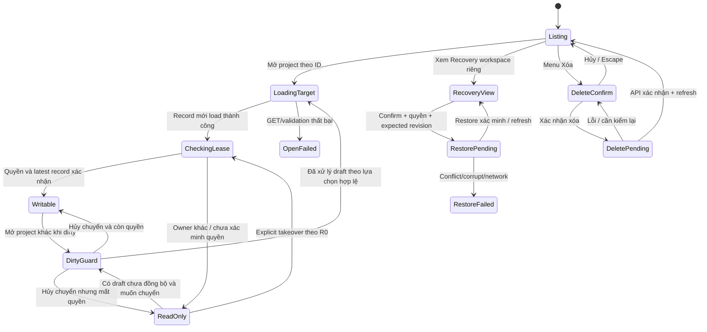

# UI-05 — Project Management Specification v1.0

**Dự án:** AI Music Video Studio — Hòa Âm

**Trạng thái:** Approved for Design — Not Implemented

**Loại giao diện:** Dedicated Project Management Workspace

**Design System:** Minimal Professional v1.0

## 1. Mục tiêu

Thiết kế một khu vực quản lý tập trung cho toàn bộ vòng đời dự án video, bao gồm:

- Tạo, mở, đổi tên và tìm kiếm dự án.
- Danh sách dự án gần đây.
- Manual Save và đóng gói project.
- Recovery và import project.
- Phát hiện, xử lý media bị thiếu.
- Xóa dự án an toàn.
- Bảo toàn Editor state, revision, lease, history và các background jobs.

Project Management hoạt động local-first, không phụ thuộc kết nối Google Drive.

## 2. Bố cục tổng thể

Project Management là workspace riêng, truy cập từ Dashboard hoặc điều hướng ứng dụng.

### Header

- Tiêu đề “Quản lý dự án”.
- Nút tạo dự án mới.
- Lối quay về Dashboard/Editor.
- Hiển thị trạng thái hệ thống nếu cần.

### Toolbar

- Tìm kiếm theo tên.
- Bộ lọc: Tất cả, Gần đây, Có cảnh báo.
- Chuyển đổi Grid/List.
- Sắp xếp dự án.
- Làm mới danh sách.

### Main Content

Hai chế độ:

**Grid View**

- Card dự án.
- Thumbnail thực tế nếu có.
- Tên dự án.
- Loại template nếu có dữ liệu.
- Metadata khả dụng.
- Trạng thái cảnh báo.
- Nút mở dự án.
- Menu thao tác.

**List View**

- Tên dự án.
- Loại dự án.
- Lần mở gần nhất nếu có metadata thật.
- Trạng thái media.
- Các thao tác.

Grid/List sử dụng cùng một nguồn dữ liệu và cùng controller.

### Secondary Workspace

Recovery có khu vực riêng trong Project Management, không đặt chung với danh sách dự án thông thường.

Các thao tác ngắn như đổi tên, đóng gói hoặc xác nhận xóa có thể sử dụng dialog.

## 3. Design System

Bắt buộc:

- Dark Slate / Charcoal.
- Lavender xám làm accent.
- `border-radius: 0`.
- Panel phẳng, đường viền mảnh.
- Segoe UI.
- Body 14px, label 13px, caption 12px.
- Spacing dựa trên bước 4px.
- Icon nhất quán.
- Hover, focus, selected, loading, disabled và error rõ ràng.
- Không neon glow, gradient trang trí hoặc shadow mạnh.

Dashboard và Project Management phải dùng chung component nền tảng, không tạo hai hệ thống project card riêng.

## 4. Project Listing

### Dữ liệu

Danh sách project phải phản ánh dữ liệu local thực tế.

Các trường chỉ hiển thị khi backend hỗ trợ hoặc metadata đã được xác nhận:

- Project ID.
- Name.
- Template type.
- Last opened.
- Duration.
- Preset.
- Media status.
- Thumbnail.

Không tự suy ra thời gian chỉnh sửa hoặc lần mở gần nhất từ thứ tự database.

### D-01 — Recent Projects

- Ghi nhận lần mở project thành công.
- Lưu lịch sử xuyên các lần khởi động.
- Không tính thao tác GET/polling là một lần mở.
- Không ảnh hưởng `contentHash`, revision hoặc Manual Save.
- Project đã xóa hoặc không còn truy cập được không được hiển thị như một liên kết mở hợp lệ.
- Không phụ thuộc duy nhất vào browser localStorage theo localhost port.

## 5. Create & Open Project

### Create

- Tạo project từ template hiện có.
- Không thay đổi template gốc.
- Không tự tạo schema/template mới chỉ để hoàn thiện giao diện.

### Open

- Load project từ backend.
- Kiểm tra trạng thái phiên và editor lease.
- Chỉ cho chỉnh sửa sau khi có quyền hợp lệ.
- Nếu project đang được chỉnh sửa ở tab khác, hiển thị read-only hoặc takeover theo luồng R0 đã nghiệm thu.
- Không sử dụng state cũ nếu quá trình load project thất bại.

### Switching Project

Khi chuyển project:

- Kiểm tra dirty state.
- Nếu có thay đổi chưa Manual Save, hiển thị cảnh báo và lựa chọn hợp lệ.
- Không tự bỏ draft.
- Không biến working save thành Manual Save.
- Không giải phóng lease sai project.
- Không hủy render hoặc AI job đang chạy chỉ vì chuyển workspace.
- Không tạo nhiều controller có quyền ghi cho cùng một project.

## 6. Rename Project

- Đổi tên thông qua action/controller hiện có.
- Kiểm tra tên rỗng, độ dài và ký tự không hợp lệ theo domain.
- Tên trùng được phân biệt bằng project ID.
- Đồng bộ danh sách sau khi cập nhật.
- Giữ revision và dirty semantics chính xác.
- Không coi đổi tên là thành công trước khi backend/controller xác nhận.

## 7. Manual Save

Manual Save là thao tác có ý nghĩa riêng, khác working save hoặc recovery tự động.

Yêu cầu:

- Hiển thị rõ trạng thái Đã lưu, Chưa lưu, Đang lưu và Lỗi lưu.
- Sử dụng snapshot/revision hợp lệ.
- Chọn thư mục qua native picker/folder grant hiện có.
- Không lưu đè dữ liệu khác khi revision conflict.
- Bảo toàn trường hợp lưu snapshot B trong khi người dùng tiếp tục chỉnh sửa thành C.
- Không đánh dấu C là đã Manual Save nếu mới chỉ lưu B.
- Đóng dialog không làm mất dữ liệu đang chỉnh sửa.

## 8. Package & Import

### Package

- Đóng gói project bằng cơ chế `.amvs` hiện có.
- Sử dụng snapshot bất biến và asset inventory được phép.
- Kiểm tra media thiếu và tình trạng file trước khi đóng gói.
- Báo cáo tiến trình và kết quả thực tế.
- Không xóa dữ liệu gốc sau khi đóng gói.
- Không coi việc tạo package là backup cloud thành công.

### Import

- Chọn file theo cơ chế an toàn hiện có.
- Kiểm tra manifest, schema, checksum và giới hạn tài nguyên.
- Không giải nén vào đường dẫn tùy ý không được kiểm soát.
- Không tự ghi đè project local.
- Thành công phải refresh danh sách project.
- Không tự loại bỏ project đang mở hoặc draft chưa lưu.

## 9. Recovery Workspace — PM-02

Recovery là khu vực riêng trong Project Management.

### Nội dung

- Chọn project.
- Danh sách recovery snapshot.
- Metadata thực tế của snapshot.
- Trạng thái hợp lệ hoặc không thể khôi phục.
- Nút xem chi tiết.
- Nút khôi phục.
- Cảnh báo về tác động tới dữ liệu hiện tại.

### Workflow

1. Người dùng chọn project.
2. Tải recovery snapshots.
3. Chọn phiên bản cần khôi phục.
4. Xem thông tin và cảnh báo.
5. Xác nhận.
6. Backend thực hiện kiểm tra và restore theo contract.
7. Refresh project và trạng thái cần thiết.

Không mặc định rằng recovery tạo project mới; Codex phải kiểm tra chính xác semantics của API local recovery, phân biệt với Google Drive restore và package import.

Không tự xóa bản recovery cũ hoặc ghi đè bản chỉnh sửa hiện tại ngoài hành vi được cho phép.

## 10. Missing Media & Relink

Nếu project có media không truy cập được:

- Hiển thị trạng thái cảnh báo.
- Liệt kê media bị thiếu bằng thông tin an toàn.
- Cung cấp action Relink.
- Kiểm tra loại file và thông tin nguồn theo khả năng backend.
- Không tự chọn file thay thế chỉ dựa vào tên giống nhau.
- Không làm thay đổi media gốc chưa được xác nhận.
- Cập nhật lại project/media status sau relink.
- Giữ đúng reference mapping và revision/history semantics.

Media Relink sử dụng các endpoint đã tồn tại, không tạo đường dẫn file tùy ý từ frontend.

## 11. Delete Project — PM-03

Xóa dự án sử dụng dialog xác nhận hai bước.

### Bước 1 — Chọn hành động

Người dùng mở menu của dự án và chọn “Xóa dự án”.

### Bước 2 — Xác nhận

Dialog hiển thị:

- Tên project.
- Cảnh báo về tác động của thao tác xóa.
- Thông tin về media/recovery nếu backend xác định được.
- Nút Hủy.
- Nút Xác nhận xóa.

Không tự xóa toàn bộ source media chỉ vì project bị xóa.

Backend phải xử lý theo chính sách asset reference/pinning và source GC.

### Quy tắc an toàn

- Không thực hiện xóa trước khi người dùng xác nhận.
- Kiểm tra quyền và trạng thái project.
- Xử lý đúng các trường hợp 409/conflict.
- Không báo thành công trước khi API xác nhận.
- Không tự giải phóng asset đang được project khác, recovery, template hoặc render job sử dụng.
- Sau khi xóa thành công, refresh project list và recent metadata.

Không bổ sung trash/undo-delete nếu backend chưa có capability đó.

## 12. UI State & Error Handling

Phải hỗ trợ:

- Loading.
- Empty project list.
- Search no results.
- API unavailable.
- Project missing.
- Read-only.
- Lease conflict.
- Dirty project.
- Save pending/failed.
- Recovery unavailable/corrupt.
- Missing media.
- Package/import failed.
- Delete pending/failed/succeeded.

Thông báo bằng tiếng Việt, có hướng xử lý phù hợp.

Không nuốt lỗi hoặc sử dụng dữ liệu mẫu thay thế cho lỗi backend.

## 13. Component Architecture

Đề xuất các component:

- `ProjectManagementWorkspace`
- `ProjectToolbar`
- `ProjectGrid`
- `ProjectList`
- `ProjectCard`
- `ProjectRow`
- `ProjectActionsMenu`
- `ProjectDetails`
- `ProjectRenameDialog`
- `ProjectDeleteDialog`
- `ProjectSaveDialog`
- `ProjectPackageDialog`
- `ProjectImportDialog`
- `RecoveryWorkspace`
- `RecoverySnapshotList`
- `MissingMediaDialog`
- `MediaRelinkDialog`

Tên component chỉ là đề xuất kiến trúc, không bắt buộc tạo file riêng cho mọi thành phần.

Giữ application controller làm nguồn dữ liệu và quyền chỉnh sửa duy nhất.

## 14. Accessibility & Responsive

- Keyboard navigation cho Grid/List, search, filters và action menu.
- Focus visible.
- Dialog focus trap và return focus.
- Menu có accessible label.
- Tên file dài không phá layout.
- Không dùng màu sắc làm tín hiệu trạng thái duy nhất.
- Kiểm thử tại 1366×768 và 1920×1080.
- Danh sách project dài được cuộn trong workspace.
- Quy tắc không cuộn toàn trang của UI-02 chỉ áp dụng Editor, không ép Project Management thành một màn hình không thể cuộn.

## 15. Acceptance Criteria

| ID | Tiêu chí |
|---|---|
| UI-PM-01 | Project Management là workspace riêng |
| UI-PM-02 | Grid/List hoạt động với dữ liệu thật |
| UI-PM-03 | Search, filter, sort hoạt động |
| UI-PM-04 | Recent Projects lưu xuyên restart |
| UI-PM-05 | Tạo/mở project đúng template và lease |
| UI-PM-06 | Chuyển project bảo toàn dirty/draft |
| UI-PM-07 | Rename đúng revision và state |
| UI-PM-08 | Manual Save bảo toàn B-save/C-edit |
| UI-PM-09 | Package `.amvs` chính xác, không mất source |
| UI-PM-10 | Import kiểm schema/checksum và không overwrite |
| UI-PM-11 | Recovery có workspace riêng và xác nhận an toàn |
| UI-PM-12 | Missing media/relink dùng đúng reference |
| UI-PM-13 | Delete có dialog hai bước, không xóa nhầm media |
| UI-PM-14 | Error, loading, empty, read-only được xử lý |
| UI-PM-15 | Keyboard, focus, responsive đạt yêu cầu |
| UI-PM-16 | Không regression lease, jobs, history, render, storage |

## 16. Phân kỳ triển khai

- **R1.B:** Dashboard navigation, Project List và các component cơ bản sau khi contract D-01 được duyệt.
- **R2/R3:** Giữ controller, lease và workspace lifecycle ổn định.
- **R5:** Project Management, Package, Import, Recovery, Relink, Delete.
- **R6:** Regression, dữ liệu thật, keyboard/accessibility và nghiệm thu.

Không thay đổi backend, API, project schema hoặc database chỉ để hoàn thành UI nếu chưa được phê duyệt.

## 17. Phạm vi chưa được tự động phê duyệt

- Duplicate project.
- Trash/Recycle Bin.
- Thumbnail generation mới.
- Bulk delete.
- Cloud collaboration.
- Project sync tự động.
- Thay đổi contract của Recovery hoặc Source GC.
- Metadata/API mới ngoài các quyết định đã duyệt.

Các chức năng này cần đề xuất, đánh giá và phê duyệt riêng.

**Kết luận:** UI-05 được phê duyệt về thiết kế; chưa triển khai hoặc nghiệm thu code.

---

# Phụ lục kỹ thuật — Project Management

**Ngày:** 24/11/2026 (Asia/Saigon). **Baseline code:** `dev`, HEAD `dc315d0`; frontend controller kế thừa R0 `d12015a`. Đặc tả PO ở trên được bảo toàn; file đính kèm ban đầu bị cắt ở “Không bổ sung trash/”, PO đã cung cấp bản đầy đủ trong hội thoại, gồm16AC. Không còn dùng phần bị cắt làm nguồn duy nhất.

**Approved:** PM-01=both (Grid/List chung nguồn/controller), PM-02=separate (Recovery workspace riêng), PM-03=confirm (menu chọn Xóa rồi dialog xác nhận). Các wireframe/component/state details dưới đây là Proposed; API/schema delta đánh dấu **Pending Technical Approval**. Đây là static analysis, không chạy delete/restore/import/relink/GC/render hoặc media thật của người dùng, không sửa code.

## A. Nguồn, minh họa và boundary

Đã xác minh các đường dẫn tồn tại: [AGENTS](../../AGENTS.md), [DS](DESIGN_SYSTEM.md), [UI-01](UI_01_DASHBOARD.md), [UI-02](UI_02_VIDEO_EDITOR.md), [UI-03](UI_03_STORAGE_MANAGER.md), [UI-04](UI_04_EXPORT_WORKSPACE.md), [Gap Analysis](UI_GAP_ANALYSIS.md), [Plan](UI_REDESIGN_PLAN.md), [MVP contracts](../architecture/MVP_CONTRACTS.md). UI-01 còn Proposed wireframe; UI-02/03/04 Approved for Design, Not Implemented. UI-04 và thay đổi duyệt ST đang ở working tree, chưa commit; giữ nguyên nội dung/quyết định. PRD/SRS/RTM/OPEN_QUESTIONS ở root, đường dẫn docs/requirements cũ chưa tồn tại; không di chuyển file.

Frontend đọc: `studio`, `project-tools`, `inspector`, `lyrics-panel`, `use-studio`, `api`, `editor-lease`; backend `app`, `store`, `snapshots`, `jobs`, `source_gc` và project/job schemas. Contracts/type versions vẫn amvs-project/1, amvs-job/1, portable/recovery/manual formats riêng; không thêm project-management schema trong task docs.

Ảnh PO cung cấp là minh họa Grid, không chứng minh List hoặc dữ liệu thật. Cards có icon placeholder chấp nhận làm fallback nhận diện nếu ghi đúng; không gọi đó là thumbnail render thật. Metadata ratio/FPS/template cần lấy từ record/API được kiểm, không suy từ vị trí card hoặc tên project. “Gần đây/Có cảnh báo” không được làm filter giả khi metadata chưa có. Hình tròn/mũi tên footer trong ảnh không tự trở thành feature hoặc ngoại lệ radius0. Chưa chép ảnh binary vào repo.

## B. Capability và API mapping

**Implemented:** có đường code. **Partially supported:** nền có nhưng thiếu UX/metadata/contract. **Missing:** chưa thấy capability. **Requires verification:** cần tests thực khi triển khai, không suy pass từ việc đọc test.

| Chức năng | Phân loại | Code/API hiện có và khoảng cách |
|---|---|---|
| List local | Implemented; richer list Partially supported | GET `/projects` từ Store.list_projects chỉ `{id,name}`, rowidDESC; không lastOpened/template/preset/duration/warning/thumbnail trong list DTO |
| Recent D-01 | Missing | Chưa thấy metadata store/open-event/recent endpoint; không biến GET/poll/rowid thành lần mở. Persistence xuyên port phải có contract ngoài content |
| Grid/List chung data | Missing về UI; API nền Implemented | Sidebar list có thật, chưa ProjectManagement/Grid/List/toggle. Đề xuất một normalized store keyedID, cùng projection sort/filter, không hai API clients/writer controllers |
| Detail metadata | Partially supported | GET projects/id trả project/view/revision/hash/dirty; có templateRef/preset/duration. Có thể hiển thị sau load thật nhưng không có aggregate listing/thumbnail endpoint project |
| Search/filter/sort | Partially supported | Name search/sort có thể local từ id/name, nhưng project UI chưa có; recent/warning sort/filter thiếu data, phải Unknown/Pending, không giả kết quả |
| Create/open | Implemented nền; PM UX Missing; Requires verification | POST projects dùng template TPL-01/02/03/domain hoặc instance mẫu; GET + adopt/EditorLease. Không clone/blank builder mới ngoài scope |
| Rename | Implemented cho current editor; noncurrent Partially supported | Inspector onBlur trim+change; PATCH expected revision guard. Schema name min1/max200, không regex filename cho tên hiển thị. Chưa PM rename-by-ID flow/pending confirmation |
| Manual Save/dirty | Implemented; PM UX Partially supported | Sync expected revision rồi POST projects/id/save `{project,revision,grantId}`, scope project; savedHashB so với currentC. Working save không manual save, không cloud backup |
| Local recovery | Implemented nền; separate workspace Missing | GET/POST recoveries, POST restore `{recoveryId,revision,confirmed:true}`; restore cập nhật working copy **cùng projectID**, tăng revision qua Store.update, giữ savedHash/manual file |
| Recovery detail/validity | Partially supported/Missing | List chỉ id/createdAt/contentHash/bytes; corrupt entries có thể bị bỏ qua và warning chung. Không preview/full detail/validity từng item endpoint; không đánh dấu “khôi phục được” chỉ vì list parse được |
| `.amvs` package | Implemented; PM background tracking Partially supported | POST projects/id/packages `{revision,grantId}` scope backup→202 job package; GET jobs/id/package sau succeeded. Deep snapshot/inventory/hash; poll nằm trong ProjectTools local async loop, chưa app-owned registry |
| Package import | Implemented; navigation-only import Missing | POST projects/open native chooser; `.amvs` manifest/schema/checksum/resource/containment validation, collisionID409, không overwrite. UI openManual hiện auto-adopt result, không import-only rồi giữ current project |
| Manual checkpoint open | Implemented; lease race Requires verification | Cùng projects/open nhưng Store.open_manual khác package: có thể cập nhật projectID có sẵn nếu working không dirty-different; dirty khác hash409. Route không leases.guard riêng; cần audit trước hứa concurrent-open an toàn toàn diện |
| Missing media/relink | Implemented nền; management display Partially supported | GET media-status→missingIDs; POST assets/id/relink `{confirmed:true}` native file chooser, size≤2GiB và **cùng checksumID**, copy stage/verify/replace; không thay assetID hoặc arbitrary media replacement |
| Delete project | Implemented nền; PM-03 modal Missing; races Requires verification | DELETE projects/id lease.guard, xóa row, trả deleted/sharedAssetsPreserved; không expected revision/body confirm/rowcount check. UI hiện window.confirm + location.reload, chưa giữ background state khi xóa |
| Source GC | Implemented; delete coupling không được thêm | GET source-gc preview, POST explicitIDs/confirmed, recheck pins dưới lock; project/recovery/manual/template/job/history refs giữ source. Không tự GC vì project DELETE |
| Lease switching | Implemented R0; PM workspace Requires verification | Single Api/controller/epoch, acquire+latest+confirm trước writable, stale callbacks fenced; release cũ có ordering. UI navigation mới không tạo authority riêng |
| Background jobs khi đổi workspace | Partially supported | Backend jobs ngoài view; useStudio chỉ một selected job, polling gắn authority; ProjectTools package loop/LyricsPanel state dễ remount. Cần ownership theo jobId ở app, không cancel chỉ vì chuyển view |

### B1. Endpoint contract cần giữ

Prefix `/api/v1`; auth/session/exact-origin và opaque grants giữ nguyên. Không thêm body fields vào API hiện hữu chỉ để khớp mockup.

| Nhóm | API hiện có | Bảo toàn |
|---|---|---|
| CRUD | GET/POST projects, GET/PATCH/DELETE projects/id | PATCH mang project/revision/view, load/new record; DELETE lease policy hiện có, không source deletion |
| Lease | POST editor-session takeover/pins; DELETE release | R0 authority epoch/project scoping, TTL/heartbeat, explicit takeover, không bỏ concurrency |
| Save | POST projects/id/save project/revision/grantId | Native scope project, hashB/manualSavedHash vs currentC |
| Recovery | GET/POST projects/id/recoveries; DELETE ids/confirmed; POST restore recoveryId/revision/confirmed | Same working project, expected revision, checksum/schema; clear explicit riêng, không auto-clear |
| Package/import | POST projects/id/packages revision/grantId scope backup; GET jobs/id/package; POST projects/open native chooser | Snapshot/inventory, no overwrite package import; manual open khác semantics |
| Media | GET projects/id/media-status; POST assets/id/relink confirmed | ID/hash exact, native picker/cancel, no raw path/no filename matching |
| GC | GET storage/source-gc; POST ids/confirmed | Recompute pins, source bytes giữ khi referenced; không chung confirmation project delete |
| Jobs/output | GET jobs/list/id, cancel; output/package result existing | Background tracking không bị view reset; chỉ terminal thật mới link output |

## C. Wireframes — Proposed số đo, Approved PM decisions

1366×768 và1920×1080; content padding24/gap16, header/toolbar footprint ổn định, body danh sách scroll theo workspace. Không áp no-page-scroll Editor lên mọi trang PM. Segoe UI14/13/12, radius0, low-saturation lavender; shared ProjectCard/Row với Dashboard. Search/filter/view/sort chỉ view state, không revision/dirty/lease mutation.

### C1. Grid và List — chung query/projection

```text
Quản lý dự án             [Import] [Tạo dự án] [Dashboard / Editor]
[Tìm theo tên...............................] [Làm mới]
[Tất cả] [Gần đây*] [Có cảnh báo*] [Sort hợp lệ] [Grid][List]
GRID:
┌ Project A · ID...     ┐ ┌ Project B · ID...     ┐
│ thumbnail thật/fallback│ │ thumbnail thật/fallback│
│ metadata đã load      │ │ Chưa có thông tin     │
│ [Mở dự án] [Menu ⋯]   │ │ [Mở dự án] [Menu ⋯]   │
└───────────────────────┘ └───────────────────────┘
LIST (cùng IDs/order/filter; không fetch authority/controller mới):
Tên/ID | Loại* | Lần mở* | Media* | [Mở][Menu ⋯]
```

Dấu* chỉ metadata cần nguồn thật. Chưa có data không tương đương “không cảnh báo”; empty khác error/no-results. Đừng hàng loạt GET full projects mỗi toggle để tự tạo metadata/recent; mỗi GET còn pin asset trong session baseline. Nếu hydrate details theo nhu cầu phải cache/generation/budget có giới hạn; aggregate metadata cần PM-T01 review.

### C2. Recovery workspace riêng — PM-02

```text
Project Management / Recovery                  [Quay lại danh sách]
[Chọn project theo ID/tên trùng được phân biệt]
Danh sách snapshots          | Chi tiết snapshot được chọn
Thời điểm/hash/bytes thật    | metadata hiện có; validity Unknown
[Snapshot R1] [Snapshot R2]   | warning: cập nhật WORKING của project này
Warning corrupt/cap từ API   | manual checkpoint giữ nguyên
                             | [Hủy] [Khôi phục bản làm việc]
```

Không dialog recovery trộn trong project cards. Detail/preview/invalid rows chưa có endpoint phải ghi capability gap, không fabricated history. Không tự open/discard current project khác khi chọn project để xem recovery.

### C3. Delete — PM-03 chính xác hai bước

Bước1: menu card/row → “Xóa dự án”. Bước2: dialog “Xác nhận xóa dự án” với tên+ID, tác động được backend xác định, Hủy/Xác nhận xóa. Không thêm hai modal liên tiếp hoặc gõ lại tên như điều kiện Approved chưa có.

```text
Xác nhận xóa dự án                                [Đóng ×]
<Tên project đầy đủ> · <ID>
Xóa khỏi danh sách working local. Source dùng chung/manual file giữ.
Không có Trash/Undo delete. Recovery còn giữ không đồng nghĩa mở lại được.
<dirty/quyền/background/missing details từ nguồn thật>
                            [Hủy] [Xác nhận xóa]
```

Focus mặc định Hủy, keyboard/Escape không DELETE. Chỉ submit sau click xác nhận; pending chống double-submit, success sau API+refresh. Không toast-only error409. DELETE không expected revision và luôn trả deleted:true kể cả row đã mất ở baseline: không hứa atomic stale-confirm protection chưa có; PM-T05 cần review. Không location.reload để ép danh sách mới vì có thể mất draft/job tracking.

## D. State machines và navigation

Project identity, UI view, authority, dirty và jobs là các trục riêng, không gộp thành “project saved”. Grid/List/Recovery/Storage/Dashboard view switch không tạo project session mới; chỉ open project khác mới đi qua guard/lease lifecycle.



Diagram không khôi phục writable từ snapshot UI. Job lifecycle UI-04 độc lập diagram này; package/AI/render vẫn chạy khi chỉ navigation. Listing có Loading/Empty/NoResults/Unavailable riêng; không sample cards thay API fail. Không gắn old record của A dưới tên targetB khi loadB thất bại; giữ contextA rõ hoặc target error, không staleB writable.

### D1. Dirty guard Proposed

Navigation chia2loại: đổi workspace với project đang mở thì giữ project/history/lyrics draft/selection/playhead/job/controller; đổi project hoặc import-auto-open/restore same project ảnh hưởng content thì cần guard.

Nếu dirty: đề xuất dialog “Lưu thủ công rồi tiếp tục / Giữ bản làm việc và tiếp tục / Ở lại”. Không tự suy lựa chọn “Giữ bản làm việc” an toàn nếu draft chỉ trong memory, mất quyền hoặc sync thất bại: phải giữ tại tab/cache được review hoặc chặn rời với lý do, không báo đã lưu. Khi chọn Manual Save, chờ backend xác nhận snapshotB; nếu user đã editC thì C vẫn dirty, không tự coi guard đã giải quyết — kiểm lại dirty/current generation trước tiếp tục.

Existing canLeave chỉ confirm + writable sync rồi adopt; confirm không phải cơ chế lưu lyrics input chưa apply, history xuyên project hay cache draft read-only. Đề xuất PM-T02 chốt retention/state scope và actions trước implementation. Không tự persist draft vào project schema/preferences để né quyết định. Cancel picker/save fail/409 → giữ source context và draft, không navigate. Không giải phóng lease A trước khi target flow chuẩn bị đúng; giữ ordering R0, không release nhầmB hoặc tạo Api mới.

## E. Flows dữ liệu và độ tin cậy

### E1. Create / open / rename

Create từ TPL-01/02/03/domain hoặc immutable personal template instances đã có; không bịa duplicate/blank/new-schema. Success refresh list chung, đi qua adopt/lease, recent chỉ khi open-event semantics đã được duyệt. Native file import không là create template.

Open lấy targetID, generation, load record/schema, authority controller R0 acquire→load latest→confirm rồi editable. Read-only là kết quả hợp lệ để xem/takeover; không giữ writable cũ. Error callback muộn sai project/generation không cập nhật list detail/selected project; media/recovery polling cũng cần fence khi chọn project khác.

Rename target đang edit: dùng controller/change/history/expected revision, tên rỗng sau trim bị từ chối; max200 theo schema, không ép regex Windows filename vì đây là tên hiển thị. Tên trùng vẫn hợp lệ, phân biệtID. List label đang pending có marker, chỉ xác nhận persisted sau backend success, không success toast ngay khi gõ. Noncurrent target chưa có controller action typed: cần load/lease/expected revision policy có giới hạn, không lấy revision mới rồi PATCH full stale content (PM-T03). Không tự takeover project người dùng khác để rename từ card.

### E2. Manual Save và package

Save: validate quyền → native folder scope project → sync snapshotB → POST save(expected revision/hashB/grant) → only update manualSavedHashB, so currentC để tính dirty. Cancel chooser neutral, không xóa input/thoát workspace. Working autosync/recovery/package không clear manual dirty. Kết quả checkpoint `.amvs.json` cần local library, khác portable package chứa media.

Package: quyền snapshot nguồn theo flow prepare/controller → syncB → GET current revision đúng context → native folder scope backup → POST packages revision/grant→202 → app job tracking → poll terminal → GET jobs/id/package, hiển thị filename thật. Immutable project/view/manualSavedHash/inventory được export, source giữ nguyên. Worker package completion không cloud backup và không manual save. ProjectTools poll while-loop hiện phụ thuộc view, cần extract owner ngoài dialog/workspace và chống stale result khi user chọn targetC.

### E3. Import không mặc định auto-adopt

POST projects/open dùng native chooser: cancel không action; `.amvs` đi import_package, `.amvs.json` đi open_manual. Không frontend arbitrary path. Package verify bounded entries/expanded size/ratio, manifest+schema+hash+probe metadata, stage containment, existing projectID collision409 không clone/overwrite. Thành công giữ source local, refresh list chung; import-only nên để user “Mở project đã nhập” qua guard, không discard current project/draft.

Baseline openManual auto-adopt result nên UI cần tách import-result navigation khỏi persistence endpoint. Thay flow frontend có thể tận dụng response RecordState; không thêm endpoint nếu chưa cần. Tuy nhiên manual open có thể **cập nhật recordID hiện có** (khác `.amvs` import) và chưa lease.guard ở route; không được gọi import preview/read-only làm mutation trái quyền. PM-T04 cần review bảo vệ concurrent manual-open/auto-adopt before full claim. Không hứa ID mới hoặc import duplicate khi code hiện từ chối.

### E4. Recovery: working replacement, không new project

1. Chọn target projectID để xem snapshots trong workspace riêng. Lấy list thật id/createdAt/hash/bytes/warning; missing/corrupt warning không fabricated invalid item. Metadata list không là full verification.
2. Chọn recovery, xem chi tiết khả dụng; endpoint detail/prevalidation chưa có thì ghi Unknown/Pending Technical Approval, không checkbox “hợp lệ” giả.
3. Trước restore: xử lý dirty/input drafts/history ảnh hưởng **target**; lấy quyền writer hợp lệ explicit theo R0 nếu cần. Không auto takeover khi chỉ xem Recovery. Không refresh revision rồi overwrite draft chưa consent.
4. Confirm nêu “Thay bản làm việc của <projectID>; bản lưu thủ công không đổi”, expected revision đúng lúc user chấp nhận; POST restore `{recoveryId,revision,confirmed:true}`. Server guard + format/id/hash/schema/Store.update validate;409 giữ draft và yêu cầu review lại.
5. Success cùng targetID, working revision tăng; manualSavedHash/manual checkpoint giữ nguyên. Dirty tùy restored content hash so manualSavedHash (có thể clean nếu đúng nội dung đã save), không luôn “chưa lưu” hoặc luôn clean. Reload/adopt target chỉ sau server xác minh, history reset theo semantics R0 có thông báo; không tự replay old history vào restored snapshot.
6. Refresh target detail/list/media; không tự open target khác thay current Editor draft. Không auto clear snapshots. Corrupt/cap warning có action phù hợp; clear explicit flow riêng theo existing API, không gắn cleanup vào restore.

Sau DELETE project, recovery files có thể còn/pin nhưng list/restore hiện gọi Store.load trước, project không tồn tại thì không truy cập được qua API này. Không hứa “xóa rồi khôi phục bằng Recovery” hoặc Undo delete/Trash. Policy orphan recovery/retention/access cần PM-T05/06 review, không tự xóa files để dọn UI.

### E5. Relink đúng immutable asset

User chọn thiếu/hỏng assetID → POST assets/id/relink confirmed→native picker. Cancel neutral; file≤2GiB và digest **bằng assetID cũ**; stage copy/hash lại rồi replace managed library copy. Không match tên file, không nhận raw path, không gán asset khác/đổi checksum để vừa project. Endpoint hiện không probe lại loại tùy chọn khi đã exact hash; byte identity giữ metadata/provenance cũ, không quảng cáo replacement transcoding.

Success refresh assets + media-status cho các views liên quan. Vì ID/bytes intended giữ nguyên, relink này không phải content edit/history command hoặc reason reset manual dirty. Trường hợp thay media bằng file khác là task/domain action khác cần duyệt, không tự gọi là relink hiện hữu. UI cũ có thể báo “đã kiểm tra” dù picker canceled; PM phải phân biệt kết quả `{cancelled:true}` và `{relinked:true}`.

### E6. Delete khác GC

PM-03 menu→confirm, targetID/name thật, dirty/background/lease impact rõ. Focus Hủy; không gửi DELETE trước confirm hoặc khi chỉ mở modal. Không lấy callback target hiện tại sau list reorder; captureID/generation, revalidate selected target và permissions. API lease.guard vẫn giữ,409 không auto retry bypass.

DELETE chỉ bỏ project row, không source/manual file/job/recovery cleanup trong handler. Response hiện không revision precondition/rowcount distinction; thêm atomic expected-revision/delete-impact DTO nếu cần là **Pending Technical Approval**, không gửi unsupported body. Sau success refresh list/recents; active project đã xóa cần detach/reconcile có kiểm soát thay location.reload. Active jobs vẫn có snapshot/pins và output; không cancel hoặc DELETE grants theo project list disappearance. Policy chặn xóa current dirty/rendering project hay cho xóa sau explicit warning cần PM-T05, không tự chọn destructive behavior.

Source GC là thao tác riêng: preview candidates → explicitIDs → confirmation riêng → recompute references dưới lock → delete permitted copies only, failed unlink khôi phục catalog entry. Manual/legacy/session pins giữ bảo thủ; project/recovery/template/job refs giữ nguồn dù xóa một project. Không gọi GC tự động sau DELETE, không báo freed bytes khi chưa có actual result. Không dùng PM modal Xóa làm consent cho cả source GC.

## F. Component ownership và accessibility

```text
Application controller (project/history/lease/job authority một nơi)
├── Workspace navigation + DirtyGuard (proposed)
├── ProjectCatalogViewModel (IDs + shared query/filter/sort, no second writer)
│   ├── ProjectManagementWorkspace / ProjectToolbar
│   ├── ProjectGrid → shared ProjectCard (Dashboard reuse)
│   └── ProjectList → ProjectRow (cùng data projection)
├── RecoveryWorkspace (route/subworkspace riêng PM-02)
│   └── ProjectSelector / RecoverySnapshotList / SnapshotDetails
├── ProjectActionsMenu → Rename/Save/Package/Import/Delete dialogs
├── MissingMediaDialog / MediaRelinkDialog
└── AppJobRegistry (render/package/AI, independent workspace visibility)
```

Tên component là proposed, không bắt buộc file riêng và không tạo data cache/writer thứ hai. Selected card/viewMode/filter là UI state; openproject authority/history/draft và background jobs ở app scope. Xem detail/recovery không tự adopt Editor target hoặc claim lease. D-04 persistence viewMode/sort ngoài content còn contract, không ghi vào project chỉ để nhớ Grid/List.

Native list/article/table semantics trước; không gán role=grid nếu chưa thiết kế arrow-navigation đầy đủ. Toggle Grid/List labelled “Chế độ hiển thị” và aria-pressed/selection đúng; focus ổn định khi đổi view vào cùng projectID. Search input có label, empty/no-results/errors bằng chữ, full project name/ID available. Menus keyboard Arrows/Escape, dialogs trap/return focus, delete initial Hủy, no nested buttons trong card. Rows 32px+targets, tên dài wrap/ellipsis + focus detail; không màu warning đơn lẻ. Keyboard và NVDA/IME/zoom/1366×768/1920×1080 cần kiểm khi code, chưa pass từ ảnh.

## G. Error-state matrix

| Tình huống | UI/state/action | Bảo toàn |
|---|---|---|
| Loading list/detail | Skeleton/aria-busy, context target đúng | Không dữ liệu mẫu thay backend |
| Empty/no-results | CTA tạo hoặc xóa search/filter | Không nhầm API error thành empty |
| API unavailable/401 | Last-known stale label hoặc error/khôi phục session | Không writable giả/auto discard |
| Project missing404 | Target unavailable, refresh; recent không mở link chết | Không show oldA như projectB |
| Lease conflict/uncertain | Read-only reason + explicit R0 takeover | No auto claim writer/no revision bypass |
| Dirty/save pending/fail | Guard có lựa chọn hợp lệ, savedB/currentC đúng | Không working-save thành Manual Save |
| Rename invalid/409 | Field error/giữ input, reconcile explicit | Không overwrite stale project/giả success |
| Recovery corrupt/cap/unknown | Warning safe, verify/restore fail rõ | Manual/source giữ, không tự clear snapshot |
| Package/import fail/collision | Job terminal hoặc422/409, retry/cancel theo capability | No overwrite/current draft discard, no cloud success |
| Relink cancel/checksum mismatch | Neutral cancel hoặc lỗi “cần cùng checksum” | ID/source/reference/dirty giữ nguyên |
| Delete pending/fail/success | Confirm/pending chống double click; success chỉ backend/refresh | Không auto GC/Trash, failed vẫn giữ row/error |
| GC stale pins/locked source | API reject/failedIDs cụ thể, refresh candidate | Không delete referenced media hoặc file ngoài scope |

Generic backend errors không đủ detail từng card/project thì ghi thiếu capability, không suy cảnh báo/validity bằng tên, rowid hoặc parse private logs. Toast không thay persistent conflict/recovery/delete failure. Async callbacks phải fence project/action/session generation, không nuốt errors khi workspace remount.

## H. Pending Technical Approval

Các PM-01/02/03 và AC gốc đã Approved for Design. Bảng này chỉ là quyết định kỹ thuật còn thiếu, không yêu cầu duyệt lại ba quyết định đó, không tự đổi endpoint/schema/DB.

| ID | Gap / cần quyết định | Hướng đề xuất và giới hạn |
|---|---|---|
| PM-T01 | D-01 recent và metadata list | Local metadata store ngoài project content, event “mở thành công” (cần chốt readonly có tính không), persist qua browser/launcher đổi port, delete/missing invalidation, bounded history; aggregate summary/nullability/budget nếu cần. Không dùng rowid/GET làm history, không tự thêm DB/API |
| PM-T02 | Dirty/draft/history navigation scope | Chốt guard options, retention/budget cho unapplied lyrics/read-only drafts/history khi đổi project; workspace-only phải giữ state. Existing single history resets on adopt, chưa hứa Undo xuyên reopen nếu chưa có contract |
| PM-T03 | Noncurrent rename và per-action permissions | Chọn flow controller/lease/expected revision phù hợp target, không auto takeover hoặc full stale PATCH; safe pending/refresh list; display name không filename validation mới |
| PM-T04 | Import-only vs open-manual mutation/lease | Tách import success khỏi auto-adopt; review manual checkpoint existingID overwrite when clean và concurrent lease policy. Package collision không đổi thành clone nếu chưa approved |
| PM-T05 | Delete stale confirmation / active dirty jobs / recovery orphans | Cân nhắc atomic expected-revision hoặc impact DTO riêng nếu cần; baseline DELETE không có. Chốt active target/navigation, no automatic job/GC cleanup, retention/access recovery sau delete; không Trash/Undo/bulk |
| PM-T06 | Recovery detail/validity API | List metadata/warning hiện có không đủ invalid rows/details/preview. Cần review safe detail/prevalidation/corrupt enumeration nếu phải hiển thị đầy đủ; restore cùngID không đổi contract ngầm |
| PM-T07 | Project thumbnail + warning summary/view preferences | Thumbnail chỉ khi có nguồn thật; generation mới cần task riêng. Unknown metadata nullable, không fake “healthy”; shared Grid/List query cache và settings ngoài content, không UI-D04 persistence giả theoport |
| PM-T08 | App background registry render/package/AI | Dùng shared app ownership/reopen, stale job callbacks/focus không reset authority; không hứa restart-resume. Endpoint mới chỉ khi code hiện chưa đáp ứng sau review, không nhân controller writer |

No duplicate/trash/new thumbnails/bulk delete/cloud collaboration/project auto-sync hoặc contract Recovery/GC mới được tự động duyệt. Package/restore immutable semantics và local-first không được đổi để vừa concept. R1.B có thể làm list/basic views bằng dữ liệu hiện có sau contract D-01; không gọi full UI-PM-02/03/04 đạt nếu richer metadata/recent/warnings vẫn thiếu.

## J. Regression matrix — UI-PM-01…16

Đã đọc tests, **chưa chạy tests mới trong task tài liệu**. Code foundations: `tests/e2e/core-workflows.spec.ts` (lyrics/recovery/package/template/two-tab), `tpl01`/`multi-media`/`music-card`; `tests/integration/test_local_api.py`, `test_mvp_completion.py`, launcher; unit domain/editing/lyrics/editor-lease. New UI-PM assertions phải bổ sung sau được giao code, không xóa/làm yếu tests cũ.

| AC gốc | Browser evidence dự kiến | Backend/domain checks và nguồn nền |
|---|---|---|
| UI-PM-01 | Workspace riêng từ Dashboard/Editor; back context đúng | No project mutation do navigation; new PM E2E |
| UI-PM-02 | Grid/List cùng IDs/data/query/sort; loading/unknown metadata thật | GET projects `{id,name}`, details validated; không fetch authoritative writer thứ hai |
| UI-PM-03 | Search tên Việt/trùng/dài/no-results, filter/sort chỉ dựa nguồn thật | Unknown warning/recent không fake; capability PM-T01/07 phải có trước nghiệm thu đầy đủ |
| UI-PM-04 | Open success events khác GET/poll; reload/browser/launcher đổiport vẫn recent; xóa/missing invalidation | Metadata ngoài content/hash/revision/manualSave; D-01 contract tests mới |
| UI-PM-05 |3templates tạo đúng, open/readonly/takeover, failedload không stale target | Existing domain/template immutability, R0 lease/epoch/revision; không auto clone |
| UI-PM-06 | Dirty/unapplied lyrics/read-only draft, Cancel guard/savefail/saveB-editC, workspace-only vs project switch | Working save khác Manual Save; R0 serial fences và history retention policy đã chọn |
| UI-PM-07 | Current/noncurrent rename pending/invalid/duplicate name/409, refresh shared list | Name1…200 theo schema, expected revision+lease, không full stale overwrite |
| UI-PM-08 | SaveB response đến sau editC; C vẫn dirty, dialog close/picker cancel an toàn | `test_revision_dirty_and_manual_race`, queued_manual_save_rechecks_owner và hash/manualfile bytes |
| UI-PM-09 | Package đang chạy khi đổi workspace/đóng dialog, terminal/link đúng | Background immutable package, checksum inventory/source unchanged; `test_package_background_job_snapshot...` |
| UI-PM-10 | Native import cancel/fail/collision, refresh list, không tự bỏ current draft | `test_portable_cross_workspace_real_bytes_no_overwrite`, archive attacks, manualSavedHash preserved; manual open race tách khỏi importpackage |
| UI-PM-11 | Recovery workspace riêng; select/view/confirm/409/corrupt/unknown/cap; history warning | `test_recovery_separate_manual_hash_revision_and_corruption`, cap pause; sameID working update, manualfile unchanged |
| UI-PM-12 | Missing list→relink exact checksum/cancel/wrong file, no false success | Existing relink native+hash/stage path; sharedID references/contentHash/revision/dirty giữ, source matching không tên |
| UI-PM-13 | Menu→confirm2bước, Escape/Hủy không request, targetID không drift/double-submit; permissions/conflict | `test_bad_grant_rejected_and_deletion_preserves_library`, GC rechecks pins/shared/recovery/job refs; no automatic GC/Trash; stale modal race gapPM-T05 |
| UI-PM-14 | Loading/empty/no-results/API-down/projectmissing/read-only/save/recovery/import/delete errors có hướng xử lý | Labelled faults + actual status; không sample fallback/error swallowed; privacy-safe messages |
| UI-PM-15 | Keyboard Grid/List/menu/dialog/recovery, focus return, long names/IME/zoom/two viewports, workspace scroll | DS computed/radius0/contrast; NVDA manual; không đánh đồng ảnh Grid với List/accessibility pass |
| UI-PM-16 | Open/close PM/Recovery/Storage/Export, render/package/AI tracking còn, takeover lúc đang PM và quay lại | R0 stale claim/expiry/queued save; sourceGC pins, snapshot/parity, no renderer/storage contract changes |

Race bổ sung: A currentdirty, chọn targetB rồi list reorder/delete ở tab khác, stale inspect callbackA không ghi B; restore confirm đang mở thì revision target đổi; xóa project có renderB vẫn giữ sourcepins/output; GC preview rồi asset vừa được pin phải reject; package import sameID trong khi editor writer khác; GET manual open không được nghĩ read-only khi có mutation; queued B Manual Save/C edit + navigation không clear C.

Test fixtures chỉ generated media/private workspaces. Backend integrity và native picker tests riêng; transport faults phải ghi nhãn, không dùng mock pass cho thực tế filesystem. Không cần Google account cho local Project Management; cloud ST-06 thuộc UI-03 gate riêng. Không chạy xóa/restore/relink/import/GC hoặc render trên dữ liệu người dùng. Checksum/parity/source preservation và outcome backend mới là evidence, screenshot không chứng minh an toàn dữ liệu.

## K. Điều kiện triển khai và trạng thái bàn giao

- **R1.B:** shared ProjectCard/Row/Toolbar/normalized list data và navigation; D-01/metadata PM-T01 được review trước persistence/recent. Không fork Dashboard card system.
- **R2/R3:** preserve single app controller/Api/authority/history/lyrics draft/selected/playhead; workspace lifecycle không release lease sai project, job ownership độc lập active project/view. R0 acceptance giữ hiệu lực, không sửa cơ chế để UI dễ ghi.
- **R5:** PM workspace + Recovery riêng + Rename/Save/Package/Import/Relink/Delete dialogs theo PM-01/02/03; chốt PM-T02…T08 theo phần phụ thuộc, native grants/no raw paths; backend/schema delta cần review riêng. Không suy approval thiết kế thành quyền tự chạy destructive data test.
- **R6:** từng UI-PM-01…16 có browser/backend result, source/build provenance, keyboard/actual data/no-loss evidence, Not run/Blocked/Skipped rõ. Full PM gate chưa đạt chỉ vì docs/build/test nền đã có.

**Kết quả lượt này:** hồ sơ nguồn đầy đủ đã bổ sung,16AC giữ nguyên; đã khảo sát code và xây dựng wireframe/state/flow/capability/error/test matrix. Không đổi UI-01…UI-04/Design System, application/DB/schema/API; không tạo branch hoặc commit/push/merge. R5 chưa triển khai. Chờ PO review phần kỹ thuật và những điểm Pending Technical Approval, không xin duyệt lại PM-01/02/03.
