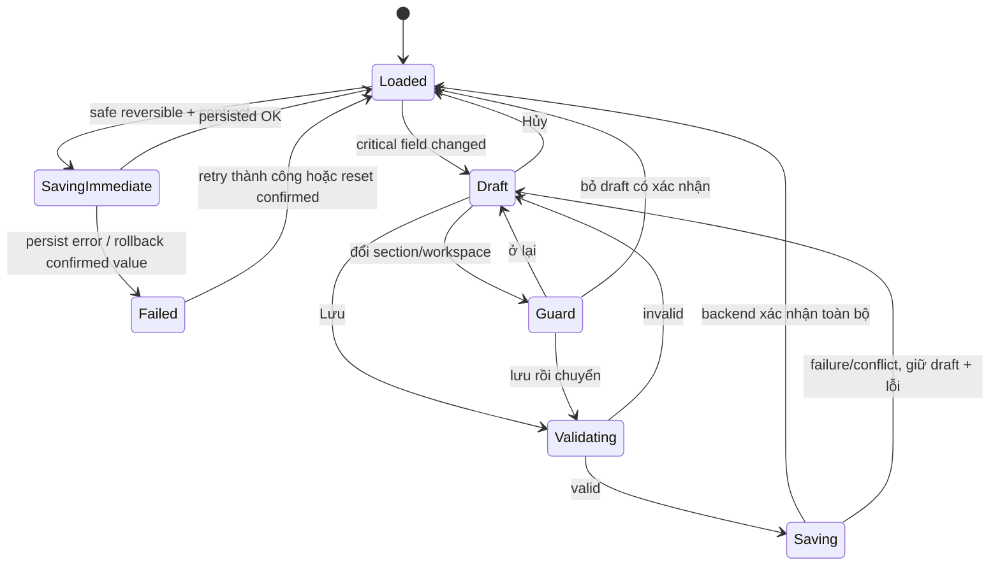

# UI-06 — Settings Workspace Specification v1.0

**Dự án:** Hòa Âm — AI Music Video Studio  
**Trạng thái:** Approved for Design — Not Implemented  
**Phiên bản:** v1.0  
**Phong cách:** Minimal Professional  
**Phạm vi:** Application Settings, không phải Project Settings

## 1. Mục tiêu

Xây dựng Settings Workspace thống nhất, giúp người dùng cấu hình và kiểm tra ứng dụng một cách an toàn.

Giao diện tập trung vào sáu nhóm:

1. Chung.
2. Giao diện.
3. Lưu trữ.
4. AI & Xử lý.
5. Google Drive.
6. Hệ thống.

Mọi cài đặt phải được phân loại theo capability thực tế. Không hiển thị chức năng chưa triển khai như một tính năng đang hoạt động.

## 2. Bố cục — STG-01

Settings là một workspace riêng.

### Header

- Tiêu đề “Cài đặt”.
- Nút quay lại workspace trước đó.
- Trạng thái lưu nếu có thay đổi.
- Không hiển thị token, secret hoặc thông tin nội bộ không cần thiết.

### Sidebar

Sáu nhóm cài đặt, dùng một sidebar điều hướng thống nhất.

- Nhóm đang chọn có marker rõ ràng.
- Hỗ trợ điều hướng bàn phím.
- Trên viewport hẹp, sidebar có thể chuyển thành navigation gọn, nhưng không được làm mất chức năng.

### Content Panel

- Một cột nội dung chính.
- Chia section bằng heading và đường viền mảnh.
- Label và mô tả ngắn đi cùng control.
- Lỗi hiển thị sát trường liên quan.
- Footer Lưu/Hủy/Đặt lại chỉ xuất hiện khi phù hợp với semantics.

### Layout

- Desktop-first.
- Kiểm thử tối thiểu ở 1366×768 và 1920×1080.
- Nội dung dài cuộn trong vùng Settings.
- Không sử dụng nhiều nested scroll không cần thiết.

## 3. Design System

Tuân thủ Design System v1.0:

- Nền Dark Slate / Charcoal.
- Accent Muted Lavender.
- Tất cả góc UI do ứng dụng tạo đều vuông: `border-radius: 0`.
- Không neon glow.
- Không gradient trang trí.
- Không shadow mạnh.
- Panel phẳng, divider mảnh.
- Segoe UI cho giao diện v1.
- Body 14px, label 13px, caption 12px.
- Spacing dựa trên bước 4px.
- Focus, selected, disabled, loading và error rõ ràng.

Không thay đổi style của video composition chỉ vì Settings áp dụng Design System.

## 4. STG-02 — Hybrid Save

Phân biệt hai loại thay đổi.

### A. Áp dụng ngay

Chỉ dành cho tùy chọn:

- Có tác động nhỏ.
- Có thể đảo ngược an toàn.
- Không làm mất dữ liệu.
- Có persistence contract hợp lệ.

Ví dụ: chọn chế độ hiển thị danh sách hoặc thay đổi bố cục panel.

Quy tắc:

- Cập nhật giao diện ngay khi người dùng thao tác.
- Nếu cần lưu bền vững, phản ánh trạng thái persist thực tế.
- Nếu lưu thất bại, khôi phục giá trị xác nhận gần nhất hoặc thông báo trạng thái chưa lưu.
- Không hiển thị “Đã lưu” chỉ vì React state đã thay đổi.

### B. Lưu/Hủy

Dành cho cấu hình có tác động lớn hoặc cần xác minh backend.

Ví dụ:

- Thay đổi chính sách lưu trữ.
- Cấu hình kết nối.
- Cài đặt có ảnh hưởng tài nguyên xử lý.
- Các thay đổi cần xác nhận quyền hoặc consent.

Quy tắc:

- Dùng draft form riêng.
- Validate trước khi gửi.
- Chỉ commit khi người dùng chọn Lưu.
- Hủy trả về giá trị đã xác nhận.
- Không áp dụng một nửa cấu hình khi API thất bại.
- Khi chuyển section với draft chưa lưu, có dirty guard dành riêng cho Settings.

Không sử dụng project dirty state cho settings draft.

## 5. Nhóm 01 — Chung

Mục đích: các thiết lập cơ bản của ứng dụng.

Nội dung:

- Ngôn ngữ giao diện.
- Khôi phục cấu hình giao diện mặc định.
- Các tùy chọn ứng dụng cơ bản được backend/frontend hỗ trợ.

Tiếng Việt là mặc định.

Không hiển thị lựa chọn tiếng Anh hoặc ngôn ngữ khác như đang hoạt động nếu hệ thống chưa có bản dịch đầy đủ.

“Khôi phục mặc định” phải mô tả chính xác phạm vi: chỉ application preferences, không xóa project, media, recovery hoặc backup.

## 6. Nhóm 02 — Giao diện

Áp dụng D-04 — UI Preferences độc lập Project Content.

Có thể bao gồm:

- Chiều cao Timeline.
- Kích thước panel.
- Công cụ đang chọn.
- Chế độ hiển thị các workspace.
- Khôi phục bố cục mặc định.

### Persistence

- Preferences được lưu riêng ngoài project content.
- Có version để hỗ trợ migration.
- Validate các giá trị khi load.
- Có default và cơ chế phục hồi nếu metadata bị hỏng.
- Không lưu token, credentials, lyrics draft hoặc dữ liệu nhạy cảm.
- Không phụ thuộc duy nhất vào localStorage khi launcher có thể đổi localhost port.
- Cần xác định rõ cách xử lý nhiều tab và atomic persistence trước implementation.

### Bất biến

Thay đổi giao diện không được làm thay đổi:

- Project content hash.
- Project revision.
- Manual saved hash.
- Undo/Redo history của project.
- Editor lease.
- Render snapshot.

## 7. Nhóm 03 — Lưu trữ

Quản lý thông tin và chính sách lưu trữ local.

### Nội dung

- Thông tin workspace local khi backend cung cấp.
- Dung lượng cache có thể xác minh.
- Chính sách dung lượng cache.
- Xóa cache tái tạo được.
- Dọn temporary files hợp lệ.
- Source Garbage Collection (GC) với preview và consent.
- Liên kết tới các chức năng quản lý dữ liệu phù hợp.

### Cache Cleanup

- Phân biệt cache tái tạo được với media source.
- Chỉ xóa các file thuộc phạm vi API cho phép.
- Không cam kết giải phóng dung lượng nếu chưa biết kết quả thực tế.
- Hiển thị trạng thái và kết quả cleanup.

### Source GC

- Chạy đánh giá đối tượng đủ điều kiện trước khi xóa.
- Hiển thị danh sách/phạm vi ảnh hưởng thực tế.
- Yêu cầu xác nhận rõ ràng.
- Tôn trọng pins của project, recovery, template, manual snapshot và background jobs.
- Không tự động xóa media source chưa được phép.
- Không dùng nút “Dọn bộ nhớ” chung để xóa cả cache và source.

### An toàn

- Không cho người dùng nhập arbitrary filesystem path trực tiếp vào API.
- Dùng folder grant hoặc cơ chế được backend cho phép.
- Bảo toàn source và recovery khi cleanup thất bại.
- Không hiển thị nhãn “Đã dọn” trước khi backend xác nhận.

## 8. Nhóm 04 — AI & Xử lý

Hiển thị thông tin và cấu hình liên quan AI/processing được hỗ trợ.

### Nội dung đề xuất

- Danh sách model ASR khả dụng nếu backend hỗ trợ.
- Trạng thái tải hoặc thiếu model nếu có API.
- Tài nguyên xử lý và các giới hạn có thể xác minh.
- Trạng thái tác vụ AI liên quan.
- Hướng dẫn xử lý khi thiếu model hoặc tài nguyên.

### Quy tắc

- Không tự tạo GPU/CPU mode selector chưa được hỗ trợ.
- Không hiển thị giả phần trăm tải model.
- Không tự thay đổi concurrency limit, admission policy hoặc render worker.
- Không tải model mới khi chưa có hành động người dùng và cơ chế xác nhận thích hợp.
- Không coi trạng thái AI model là một phần của project content.
- Các tùy chọn model gắn với một tác vụ cụ thể phải giữ đúng ownership hiện có; không tự chuyển thành global preference nếu chưa có hợp đồng.

## 9. Nhóm 05 — Google Drive — STG-03

Settings chỉ hiển thị:

- Trạng thái kết nối.
- Thông tin cấu hình an toàn nếu backend trả về.
- Trạng thái tự sao lưu theo dữ liệu backend.
- Nút mở UI-03 Storage Manager.
- Lối vào cấu hình kết nối có điều hướng tới UI-03.

Các hành động chính như:

- OAuth configuration.
- Connect/Disconnect.
- Backup.
- Restore.
- Transfer progress.
- Transfer cancellation.
- Snapshot history.

được quản lý tập trung tại UI-03.

Không tạo hai controller riêng hoặc hai nguồn trạng thái khác nhau cho Google Drive.

Không ghi credentials vào localStorage, project JSON, logs hoặc analytics.

Google Drive mất kết nối không được khóa Editor local.

## 10. Nhóm 06 — Hệ thống

Hiển thị thông tin hệ thống phục vụ người dùng.

Nội dung:

- Phiên bản ứng dụng nếu có nguồn tin cậy.
- Trạng thái local backend.
- Thông báo mất kết nối.
- Thông tin lỗi an toàn.
- Cơ chế kiểm tra/chẩn đoán nếu hiện có.
- Thông tin cập nhật hoặc tài liệu hướng dẫn nếu có nguồn chính thức.

Không hiển thị:

- Bearer token.
- Editor capability token.
- OAuth credentials.
- Raw secret.
- Full stack trace chứa dữ liệu nhạy cảm.
- Private local filesystem path không cần thiết.

Nếu có chức năng xuất diagnostics, dữ liệu phải được lọc secret trước khi xuất và người dùng phải chủ động thực hiện.

## 11. Navigation & State Lifecycle

- Từ Dashboard hoặc Editor có thể mở Settings.
- Settings không tự unmount application controller hoặc reset project.
- Khi mở từ Editor, quay lại phải phục hồi đúng workspace và trạng thái phù hợp.
- Background jobs tiếp tục hoạt động nếu backend hỗ trợ.
- Không tự release editor lease khi chỉ mở Settings.
- Session hết hạn phải được phản ánh chính xác.
- Khi đổi section có draft chưa lưu, hiển thị xác nhận.
- Reset UI layout không được reset project content.
- Không tạo state global thứ hai xung đột với controller hiện tại.

## 12. Error & Feedback Matrix

Phải phân biệt:

- Loading.
- Empty.
- Unsupported.
- Read-only information.
- Saving.
- Saved.
- Unsaved settings draft.
- Validation error.
- Persistence failure.
- Backend disconnected.
- Google Drive disconnected.
- Cache cleanup pending/failed.
- GC preview pending.
- GC confirmation.
- GC failed/succeeded.
- AI model unavailable.
- Settings version migration/fallback.

Lỗi phải có nội dung tiếng Việt, nêu được hướng xử lý và không chỉ sử dụng màu sắc để truyền đạt trạng thái.

## 13. Accessibility

- Điều hướng hoàn toàn bằng bàn phím.
- Nhãn đúng cho mọi field và toggle.
- Focus indicator rõ.
- Thông báo lỗi có liên kết với field.
- Dialog confirmation có focus trap/return focus.
- Disabled control có lý do có thể đọc được.
- Reduced motion.
- Zoom/reflow hợp lý.
- Không mất nội dung khi tên giá trị hoặc thông báo dài.

## 14. Component Architecture — Proposed

Các thành phần đề xuất:

- `SettingsWorkspace`
- `SettingsNavigation`
- `SettingsSection`
- `SettingsField`
- `SettingsStatus`
- `SettingsSaveBar`
- `SettingsResetDialog`
- `GeneralSettings`
- `AppearanceSettings`
- `LocalStorageSettings`
- `AIProcessingSettings`
- `DriveSettingsSummary`
- `SystemInformation`
- `CacheCleanupDialog`
- `SourceGCPreviewDialog`

Tên component chỉ là phương án thiết kế; không bắt buộc mỗi component thành một file riêng.

Ưu tiên tái sử dụng Design System primitives từ R1.

## 15. Capability Classification

Codex phải phân loại từng setting:

1. **Implemented** — đã có logic và API thực.
2. **Partially supported** — có một phần cần mở rộng.
3. **Proposed** — mới là nhu cầu UI/UX.
4. **Requires verification** — cần kiểm tra code hoặc tests.

Không được dùng mock state làm bằng chứng chức năng đã hoạt động.

## 16. Acceptance Criteria

| ID | Tiêu chí |
|---|---|
| UI-SET-01 | Settings là workspace riêng |
| UI-SET-02 | Sáu nhóm điều hướng rõ ràng |
| UI-SET-03 | Đúng Design System, góc vuông |
| UI-SET-04 | Hybrid Save hoạt động đúng semantics |
| UI-SET-05 | Settings preferences độc lập project |
| UI-SET-06 | Preferences có persistence/version/fallback an toàn |
| UI-SET-07 | Reset bố cục không thay đổi dữ liệu project |
| UI-SET-08 | Cache cleanup an toàn và có feedback |
| UI-SET-09 | Source GC có preview, consent, xác minh pins |
| UI-SET-10 | AI controls chỉ phản ánh capability thật |
| UI-SET-11 | Drive Settings liên kết với UI-03, không nhân đôi controller |
| UI-SET-12 | Session/backend/system errors được xử lý rõ |
| UI-SET-13 | Mở/đóng Settings không làm mất Editor state/job/lease |
| UI-SET-14 | Không lộ credentials, tokens hoặc dữ liệu nhạy cảm |
| UI-SET-15 | Keyboard/accessibility/responsive đạt yêu cầu |
| UI-SET-16 | Không regression project dirty, revision, history, render, Drive |

## 17. Phân kỳ triển khai

- **R1:** Design System primitives và Settings layout foundation.
- **R2/R3:** State ownership, navigation, lifecycle, D-04 persistence contract.
- **R5:** Settings workspace, storage maintenance và liên kết UI-03.
- **R6:** Browser/backend regression, keyboard, security và nghiệm thu.

Các tính năng cần backend changes phải được mô tả thành technical contract và được phê duyệt trước khi viết code.

## 18. Phạm vi chưa được tự động phê duyệt

- Tạo AI model manager mới.
- Cài thêm model tự động.
- Thay đổi engine render hoặc concurrency.
- Thêm cloud sync ngoài Google Drive flow hiện có.
- Thay đổi nơi lưu source tùy ý.
- Thay đổi database schema.
- Tạo secret storage mới.
- Tạo theme engine nhiều chủ đề.
- Thay đổi project/video preset thông qua global Settings.

**Kết luận:** UI-06 Approved for Design — Not Implemented. Các chi tiết API, persistence và capability còn thiếu vẫn phải được review riêng.

---

# Phụ lục kỹ thuật — đối chiếu implementation

**Baseline:** `dev`, HEAD `dc315d0`, khảo sát tĩnh 24/11/2026. STG-01 workspace riêng, STG-02 hybrid, STG-03 summary/link tới UI-03 đã Approved. Wireframe và component dưới đây là đề xuất; chưa kiểm thử giao diện mới. Ảnh PO là minh họa bố cục, không xác nhận capability của control.

## A. Nguồn và capability mapping

Đã đối chiếu [AGENTS](../../AGENTS.md), PRD/SRS/RTM/OPEN_QUESTIONS ở root (đường `docs/requirements` trong AGENTS chưa tồn tại), [Design System](DESIGN_SYSTEM.md), [UI-01](UI_01_DASHBOARD.md), [UI-02](UI_02_VIDEO_EDITOR.md), [UI-03](UI_03_STORAGE_MANAGER.md), [UI-04](UI_04_EXPORT_WORKSPACE.md), [UI-05](UI_05_PROJECT_MANAGEMENT.md), [Gap Analysis](UI_GAP_ANALYSIS.md), [Plan](UI_REDESIGN_PLAN.md), [MVP contracts](../architecture/MVP_CONTRACTS.md), frontend `studio`, `use-studio`, `project-tools`, `drive-panel`, `lyrics-panel`, Api client; backend `app`, `storage_policy`, `source_gc`, `jobs`, `providers`, `drive` và regression tests. UI-03/04/05 hiện có thay đổi chưa commit; không sửa nội dung các tài liệu ấy.

| Hạng mục | Phân loại | Bằng chứng và giới hạn |
|---|---|---|
| Settings workspace/sáu section | Proposed | `Studio` có sidebar dự án, `ProjectTools` chứa storage controls, `DrivePanel` đặt trong Studio; chưa có Settings route/view |
| Application UI preferences/D-04 | Proposed; Requires verification khi làm | Không thấy versioned app preference store/API; `useStudio` giữ zoom/panels trong React state. Chưa có persistence xuyên reload/restart/đổi localhost port. localStorage theo origin đơn lẻ không đạt D-04 |
| Storage quota/reserve | Implemented backend; Partially supported UX | GET/PATCH `/api/v1/storage/policy`; `runtime/storage-policy.json` atomic replace, validated cache 32–4096 MiB/reserve 2–64 GiB. `ProjectTools` có form và Save; chưa Settings draft guard/Cancel |
| Cache count/cleanup | Implemented; Partially supported UX | `storage/policy` trả `cacheBytes/freeBytes`; POST `storage/cache/cleanup` cần confirmed, chỉ thumbnail cache tên hash.jpg; kết quả `deleted/failed/sourceMediaPreserved`. UI hiện báo chung; Settings phải phản ánh partial failure |
| Temp cleanup | Implemented; Partially supported UX | GET `storage/temp` inventory job; POST `storage/temp/cleanup` ids+confirmed; chỉ temp job đủ điều kiện; UI dùng `window.confirm`, chưa dialog Design System |
| Source GC/pins | Implemented; Requires verification khi chuyển UI | GET/POST `storage/source-gc`, explicit IDs+confirmed, server recheck pins; source được project/recovery/manual/template/job/history tham chiếu phải giữ. UI có preview danh sách nhưng xác nhận bằng window.confirm. Không gộp với cache cleanup |
| AI provider/model | Implemented status; Proposed global controls | GET `ai/providers` trả local `small/medium` availability dựa Python/model.bin, cloud providers disabled. ASR model là input job `lyrics/jobs`; không có API cài model/global CPU/GPU/concurrency; trạng thái filesystem không chứng minh model chạy được đến cuối |
| Drive status/ownership | Implemented backend; Partially supported UX | GET `drive` trả connected/configured/folderName/lastBackup/autoSync; `DrivePanel` đang giữ poll/state/form. Settings chỉ đọc summary và điều hướng tới UI-03, dùng cùng owner/status; không thêm OAuth/backup/restore controller |
| System diagnostics | Partially supported | GET `/health` trả ok/application; GET `/api/v1/session` trả scope/local/Drive/templates/upload limit; chưa thấy app version/diagnostics export API. Không hiển thị version hoặc stack trace tự suy |
| Session/lease/workspace switch | R0 lease Implemented; Settings transition Proposed/Requires verification | `useStudio` sở hữu controller và lease; Settings chưa tồn tại. View switch phải giữ mounted owner, heartbeat/job poll, dirty project; return kiểm quyền hiện hành. Không release lease vì đổi section/view |

**Persistence audit:** backend storage policy và Drive state có runtime file xuyên launcher restart, độc lập browser port. D-04 UI preferences chưa có persistence đã kiểm chứng; UI toggles/React state không phải bằng chứng. Kiểm thực tế reload, launcher restart, đổi port và hai tab là gate R6 sau khi contract được duyệt.

## B. Desktop wireframe và component ownership

```text
┌ Cài đặt ─────────────────────────────── trạng thái settings ─ Trở lại ┐
│ Chung           │ Tiêu đề section                           │
│ Giao diện       │ Nhãn + mô tả + control / unsupported reason│
│ Lưu trữ         │ Divider; lỗi sát field                     │
│ AI & Xử lý      │ Nội dung cuộn một vùng chính                │
│ Google Drive    │ Drive summary → Mở Kho lưu trữ UI-03       │
│ Hệ thống        │ [Hủy] [Lưu] khi có draft hợp lệ             │
└─────────────────┴──────────────────────────────────────────────┘
```

`SettingsWorkspace` giữ selectedSection/returnTarget, `SettingsNavigation` sáu mục, `SettingsSection` + fields/status/savebar; `GeneralSettings`, `AppearanceSettings`, `LocalStorageSettings`, `AIProcessingSettings`, `DriveSettingsSummary`, `SystemInformation` là view. Dialog reset/cache/GC tái dùng R1 primitives. Ở 1366×768/1920×1080, chỉ content dài cuộn; sidebar chuyển navigation gọn khi cần, không làm mất section. Workspace switch giữ application controller ở tầng cha; Drive summary dùng cùng Api/status subscription với UI-03, không tạo poller ghi riêng.

## C. Hybrid Save, section navigation và persistence



Settings dirty và project dirty là hai state độc lập. Immediate chỉ dùng khi backend/preferences persistence contract có xác nhận; hiển thị pending/rollback khi thất bại. Storage policy là nhóm Lưu/Hủy: draft local, validate đúng bounds backend; gửi một PATCH atomic rồi refresh authoritative state. Cache/GC là action riêng có preview/confirm, không nằm trong Save bar. Reset chỉ xóa preferences theo scope được duyệt; không chạm contentHash/revision/manualSavedHash/Undo/Redo/lease/render snapshot. Khi section navigation có draft, focus dialog và return focus về mục trước; chỉ đổi section sau resolution.

**D-04 đề xuất — Pending Technical Approval:** một store app preferences riêng ngoài project content, có `schemaVersion`, allowed keys + bounds/defaults (timelineHeight, panel sizes, selected tool, workspace view); API/read-write hoặc app-owned local file độc lập localhost origin, atomic replace, migration/fallback hỏng metadata, conflict policy hai tab (version/CAS hoặc last-writer rule được PO duyệt). Không chứa secret/lyrics draft/project content. Backend endpoint/file mới, exact keys/scope và sync policy chưa được duyệt; không tạo ngay. Test reload/restart/port-change/two-tabs, kiểm project hashes/history không đổi.

## D. Cleanup và security flows

1. Cache: load policy/count → giải thích thumbnail tái tạo được → confirm → POST confirmed → đọc `deleted/failed`, refresh count; failed>0 là partial, không báo toàn bộ thành công. Source giữ.
2. Temp: GET inventory job đã kết thúc → chọn IDs hợp lệ → confirm → POST ids/confirmed → reload inventory; không hứa bytes giải phóng nếu thiếu số liệu thực.
3. Source GC: GET preview → chọn asset IDs + tên/dung lượng an toàn → dialog xác nhận riêng → POST ids/confirmed → dùng kết quả `deleted/failed`, refresh preview/media status. Server recheck pins ở thời điểm xóa; preview có thể cũ. Không tự gọi GC từ delete project hoặc cache action.
4. Drive: summary chỉ đọc từ GET `drive`; nút chuyển UI-03 giữ editor controller/job/lease. OAuth credentials chỉ nhập tại UI-03 qua flow hiện có; không echo vào Settings, localStorage, log/analytics. Session bearer/editor capability token không vào diagnostic/download. Nếu đề xuất export diagnostics, cần contract redaction + consent riêng.

## E. Error-state matrix

| Case | UI và hành động |
|---|---|
| Loading/empty/unsupported | Skeleton/status; “Chưa hỗ trợ” với lý do, không control giả; empty khác API error |
| Immediate save fail | Trả confirmed value hoặc đánh dấu chưa lưu, retry; không toast “Đã lưu” |
| Draft invalid/conflict/save fail | Lỗi sát field, giữ draft, Hủy/Retry; không partial apply |
| Preference corrupt/migration | Validated defaults + cảnh báo; ghi lại chỉ theo contract được duyệt |
| Backend/session unavailable | Read-only info, retry/check launcher; không biến lease thành writable |
| Drive disconnected | Summary tách Editor local; link cấu hình UI-03 |
| Cache/temp partial failed | Hiển thị deleted/failed thật, refresh inventory; source không bị coi đã xóa |
| GC preview/confirm/failure | Pending riêng; recheck pins, IDs fail còn trong list, không fake freed bytes |
| AI unavailable | Dựa provider/model status; hướng cài đặt thủ công, không auto-install |

## F. API contract, pending decisions và regression

Giữ nguyên `/health`, `/api/v1/session`, `storage/policy`, `storage/cache/cleanup`, `storage/temp`, `storage/temp/cleanup`, `storage/source-gc`, `ai/providers`, `drive`; bearer/session headers, native grants, editor lease/TTL/revision và Drive consent. Không thêm request fields/path tùy ý vào baseline. `storage/policy` là app policy có persistence riêng; không trộn với UI prefs hay project content.

**Pending Technical Approval:** SET-T01 D-04 store/schema/version/bounds/atomic multi-tab/port behavior; SET-T02 key list, default/reset scope và immediate vs Save/Hủy từng field; SET-T03 cache/temp/GC result DTO + partial failure presentation nếu UI yêu cầu thêm; SET-T04 diagnostics/version nguồn đáng tin cậy, redaction/consent nếu xuất; SET-T05 app-level controller/job/Drive status ownership và dirty guard khi đổi view. Chỉ bổ sung backend khi contract hiện có thực sự thiếu sau review; UI-03 giữ ownership toàn bộ OAuth/backup/restore/cancel. Không có xung đột với STG-03; UI-03 gọi phần cấu hình Drive riêng, Settings chỉ summary/navigation. Ảnh minh họa có nút “X” ở header nhưng STG-01 là workspace: diễn giải “Trở lại” theo navigation stack, không tự biến thành modal.

| AC | Bằng chứng R6 cần thu thập |
|---|---|
| UI-SET-01 | Workspace route/view riêng; return target đúng, không remount controller |
| UI-SET-02 | Sáu mục keyboard/selected/heading, content tương ứng |
| UI-SET-03 | Computed radius0/colors/type/focus hai viewport |
| UI-SET-04 | Immediate success/fail/rollback và draft Save/Hủy/guard/conflict |
| UI-SET-05 | Hash/revision/manualSavedHash/history/lease bất biến khi đổi prefs |
| UI-SET-06 | Reload, launcher restart, port change, corrupt version, two tabs |
| UI-SET-07 | Reset layout không mất project/draft/selection/job |
| UI-SET-08 | Cache source bytes giữ, partial failed feedback/backend test |
| UI-SET-09 | GC preview/consent/server pin recheck/stale selection/no source loss |
| UI-SET-10 | Provider status thật; missing model, no fake controls/install |
| UI-SET-11 | Drive summary trùng backend, UI-03 điều hướng, one owner/poller |
| UI-SET-12 | Session expiry, backend offline, system errors/health |
| UI-SET-13 | Editor return, R0 takeover/expiry, render/AI/package job continuity |
| UI-SET-14 | Secret/token redaction trong UI, logs, diagnostics và artifacts |
| UI-SET-15 | Tab/ShiftTab/Escape/focus trap-return, labels, NVDA, zoom/reflow |
| UI-SET-16 | DirtyB/C, revision, Undo/Redo, snapshot/pins, Drive consent regression |

**Test nền hiện có:** integration storage/GC/pins/lease/model unavailable/Drive transport; E2E Drive settings và core workflows. Chưa chạy lại trong task tài liệu; phải bổ sung browser Settings thật và backend preference contract tests, không suy UI-SET Passed từ test nền. R1 primitives/layout; R2/R3 ownership và D-04 contract; R5 workspace/storage flows/Drive link sau approval kỹ thuật; R6 đủ 16 AC và evidence browser/backend trên fixture riêng. Chưa đủ điều kiện nghiệm thu hoặc triển khai backend delta khi SET-T01…05 còn mở.
