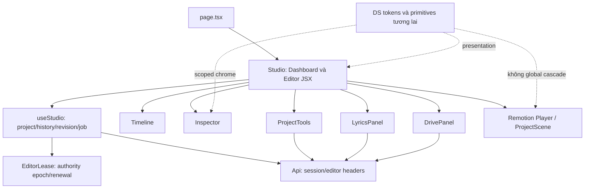

# UI Design Audit — Hòa Âm

**Ngày:** 24/11/2026 (Asia/Saigon) · **Code baseline:** `dev`, `d12015a`.

**Phạm vi:** static audit phục vụ [Design System v1.0](DESIGN_SYSTEM.md), không triển khai code/CSS, không phải accessibility conformance report. R0 lease đã được PO nghiệm thu riêng trong phiên, xem [bản ghi](UI_R0_LEASE_FIX_RESULTS.md#po-acceptance-r0). Style Minimal Professional Approved; tokens/primitive/layout details Proposed, chờ PO.

**Cập nhật quyết định PO:** sau audit baseline, DS-P01…DS-P07 đã được duyệt theo phạm vi [DS§11](DESIGN_SYSTEM.md#11-quyết-định-po--ds-p01ds-p08); DS-P05 chỉ duyệt thử hai viewport, DS-P08 yêu cầu [UI-03 riêng](UI_03_STORAGE_MANAGER.md) hiện Proposed. Các câu “chưa có UI-03/chờ PO” bên dưới mô tả thời điểm baseline, không thay quyết định mới. Chưa sửa application code trong lượt ghi nhận này.

## 1. Nguồn và phương pháp

Đã đọc AGENTS, UI-01, UI-02 nguyên văn, Gap Analysis/Plan, R0 diagnosis/results, D-01…D-06 trong Gap Analysis (không có tài liệu quyết định riêng), ADR-0001/0002 và MVP contracts. PRD/SRS/RTM/OPEN_QUESTIONS nằm root; docs/requirements chưa tồn tại. Không tìm thấy `UI_03` hoặc spec Storage độc lập. Ảnh PO gửi có mục03 kho lưu trữ, không phải văn bản yêu cầu mới.

Frontend đọc: `apps/web/app/{page,layout}.tsx`, `globals.css`, `postcss.config.mjs`, `next.config.ts`, `package.json`, sáu `components/*.tsx`, `hooks/use-studio.ts`, `lib/{api,editor-lease}.ts`; shared composition/domain và test inventory để xác định boundary. Các ghi nhận bên dưới là code evidence, không khẳng định bug runtime chỉ từ static scan. Không mở/sửa project người dùng trong lượt audit.

Kiểm bằng đọc file + `rg`, đếm HEX/selectors, tính luminance sRGB/contrast bằng Python stdlib. Không cài tool audit/font/UI library. Không chạy screenshot mockup hoặc browser mới; ảnh gửi là concept, không là kết quả app hiện tại.

## 2. Hiện trạng stack, tokens và typography

| Vùng         | Evidence code                                                                                                                   | Kết luận / hướng tận dụng                                                                                                                                                                     |
| ------------ | ------------------------------------------------------------------------------------------------------------------------------- | --------------------------------------------------------------------------------------------------------------------------------------------------------------------------------------------- |
| CSS pipeline | `globals.css:1` import tailwindcss; `postcss.config.mjs:1` dùng @tailwindcss/postcss; `apps/web/package.json` pin Tailwind4.3.5 | Có Tailwind4, không có tailwind.config được tìm thấy. Tận dụng CSS variables + CSS Modules; nếu cần utility aliases dùng CSS-first @theme của phiên bản cài, không tạo v3 config theo trí nhớ |
| Tokens       | `globals.css:40` :root có --bg/--panel/--line/--text/--muted/--accent                                                           | Tái sử dụng ý tưởng roles; tên còn thiếu elevated/control/status/focus/disabled. Không thay toàn bộ giá trị global một lần                                                                    |
| Màu          | Static regex tìm50 HEX khác nhau trong globals.css (kể cả alpha variants)                                                       | Phân tán semantic màu trong selectors; không có palette single source. DS B đề xuất roles; alpha và composition cần kiểm riêng                                                                |
| Font UI      | `globals.css:52` body Segoe UI/Arial,14px; input/button/textarea inherit                                                        | Có thể giữ Segoe UI; select chưa trong reset inherit. Cỡ chữ10/11px lặp lại ở metadata/toolbar; chuẩn hóa12px tối thiểu cho chrome proposed                                                   |
| Font Preview | `packages/composition/src/scene.tsx` có font theo style/Arial/Segoe UI                                                          | Không áp DS font vào project; UI typography tách scene/renderer. Hiện không tìm apps/web/public fonts; không suy Noto/Inter trong concept đã được bundle                                      |
| Góc/hiệu ứng | globals.css button8px, template-card13px, clip5px, tool-panel12px, field6px; nhiều radial/linear gradients                      | Xung đột rõ với Approved radius0 và Minimal Professional; chuyển sau PO duyệt implementation. Gradient audio clip hiện là pattern, chưa phải waveform thật                                    |
| Layout       | .studio-shell min-height100vh, .editor-layout2cột, Preview470/420px; breakpoint850px Inspector stack                            | Không đáp ứng layout3cột/docked/no-scroll mới; giữ đây là baseline R3, không sửa trong task docs                                                                                              |

Gợi ý kỹ thuật về `@theme` được đối chiếu [tài liệu Tailwind v4.3 chính thức](https://tailwindcss.com/docs/theme): theme variables tạo utility aliases; CSS variables không cần utility có thể giữ trong scope riêng. Đây là hướng triển khai tương lai, chưa thêm theme/config.

## 3. Component dependency và khả năng tái sử dụng

| Component / code hiện tại           | Tái sử dụng                                                                                 | Cần chuẩn hóa / rủi ro                                                                                                                                                                                                                    | Phase                |
| ----------------------------------- | ------------------------------------------------------------------------------------------- | ----------------------------------------------------------------------------------------------------------------------------------------------------------------------------------------------------------------------------------------- | -------------------- |
| `studio.tsx`428 dòng                | Handlers/state controller, template CTA tạo project thật, Player, status/save/export        | Dashboard/Editor/Drive/job inline; Unicode icons; chưa header/navigation primitives. Extract presentation dần, không remount controller khi đổi workspace                                                                                 | R1.B/R3/R5           |
| `use-studio.ts` + `editor-lease.ts` | Project authority, history/sync/manual hash, claim/epoch/reconnect đã kiểm và PO nghiệm thu | Primitive chỉ nhận permissions/callbacks; giữ pending/error và stale fences khi đổi DOM. Không “đơn giản hóa” để sửa style                                                                                                                | Regression mọi phase |
| `timeline.tsx`293 dòng              | Ticks/zoom/playhead, select/move/reorder, change qua controller                             | Ruler div onClick chưa keyboard seek; inline playhead HEX/zIndex5; pointer gesture cleanup cần review khi mở rộng; chưa dock/separator/trim handles. Không coi phát hiện mã là bug lease mới                                              | R3/R4                |
| `inspector.tsx`481 dòng             | Fieldset disabled, typed branches, onBlur text/number edits, domain validation              | Project/export/MusicCard lẫn selected clip; labels/sizes/control không đồng nhất, raw keys làm aria-label vài style fields. Field primitive không được đổi commit/IME/Undo semantics vô tình                                              | R4; field token R1.A |
| `project-tools.tsx`689 dòng         | Recovery/package/relink/GC, asset tags/search/audio, template immutable instance            | Nhiều details/tool-panel, mỗi vùng có message/busy riêng; library cards chưa shared. Media đang có thumbnail96×72/lazy+audio controls, chưa fallback/retry UI. Không đổi scope permission của catalog vs project bằng một disabled global | R4/R5                |
| `lyrics-panel.tsx`462 dòng          | Import/parse/review/apply, source mapping, job polling, draft state                         | State `lines/input/model/language` local; remount tab có nguy cơ mất draft. Modes phải preserve draft/job; typography/style ở Inspector không tự dựng engine mới                                                                          | R4                   |
| `drive-panel.tsx`306 dòng           | OAuth/consent/auto/backup/restore, typed status, error display                              | Poll2s ngay khi panel đóng; dialog extraction không được làm mất transfer state; backend chưa byte-progress/cancel đủ D-03. Không tạo progress% giả bằng component mới                                                                    | R5                   |

Dòng đếm tại baseline, không phải thước đo chất lượng. Có inline style tại Inspector1, ProjectTools1, Studio1, Timeline3. Inline geometry playhead/clip/zoom là dữ liệu động hợp lý; không gom mọi inline style thành token. HEX visual/spacing cố định mới cần alias.

## 4. CSS trùng và global leakage

**Phân biệt trùng lặp thật với override:** static scan không thấy hai block selector giống nhau ngoài các media-query overrides đã có. .navigation/.brand/.topbar/.save-state/.dashboard/.template-grid/.artwork/.editor-layout/.preview-stage/.import-bar/.inspector lặp ở1100/850px là responsive overrides có chủ đích, không được xóa vì đếm là duplicate.

| Vấn đề                                  | Vị trí evidence                                                                                                       | Hệ quả / xử lý dự kiến                                                                                                                                                               |
| --------------------------------------- | --------------------------------------------------------------------------------------------------------------------- | ------------------------------------------------------------------------------------------------------------------------------------------------------------------------------------ |
| Field rules tương tự nhưng không shared | .inspector select đầu file; .inspector input/textarea~464; .drive-settings input~620; .tool-panel textarea/select~650 | Cùng border/background/padding nhưng khác màu/radius/spacing; Field + semantic tokens, không copy block sang component mới                                                           |
| Labels và helper styles lặp ý nghĩa     | .asset-caption/.edit-hint/.rights/.preset-note small/.drive-settings small/.track-label                               | 10/11/12px và khoảng6/7/9/10/17px phân tán; dùng type-caption và spacing4px, không biến mọi margin thành cùng một giá trị                                                            |
| Global button/a                         | globals.css button/a/primary/large/disabled~70–100                                                                    | Bo góc8px/hover/opacity.45 tác động toàn app và Player controls nếu native descendants; scoped Button + explicit inheritance; không giảm opacity cả reason text                      |
| Global headings/main/footer             | main~169, h1~207, footer~307                                                                                          | h1 tới60px/letterspacing−2px có thể lan heading mới; main flex/footers padding áp sai nested dialog footer. Scope .dashboard / shell hoặc CSS Modules                                |
| Global :root/body/*                     | globals.css:40–69                                                                                                     | Theme dark/reset hợp lý, nhưng đổi body font/rules ảnh hưởng descendant composition có text chưa override. App theme namespace, chỉ reset tối thiểu; không sửa renderer để “khớp UI” |
| Focus bị tùy biến hẹp                   | Inspector input/textarea outline0 và chỉ border focus                                                                 | Không có shared focus-visible cho buttons/ruler/tabs; cần focus token, kiểm clipping khi overflow. Không kết luận toàn app keyboard pass từ có aria-label                            |
| State-only opacity                      | button:disabled.45, .upcoming.55                                                                                      | Có thể làm label khó đọc; DS disabled foreground/background riêng + reason; selected không chỉ màu                                                                                   |
| Gradient & màu không semantic           | .artwork*, .preview-stage, .clip.music; inline playhead                                                               | Bỏ decorative shell gradients; audio waveform chỉ dùng dữ liệu thật khi có; thumbnail/project artwork giữ nội dung riêng, không xóa media gốc                                        |
| Checkbox selector đụng input chung      | .inspector input:not(range) rồi override checkbox cuối file                                                           | Fragile specificity, tùy thứ tự import; primitive style theo type/variant thay bộ override cuối file                                                                                 |
| Overflow fixed heights                  | .lyrics-rows380px/.library-grid420px; .timeline-scroll x-only                                                         | Có thể giữ khả năng scroll như nền nhưng phải theo panel flex height khi R3; không cap cứng cộng dài trang                                                                           |

Đề xuất CSS scope tương lai: app token namespace (ví dụ `.hoa-am-ui`) chứa semantic vars; global chỉ reset/font shell có kiểm boundary; `ui/*.module.css` cho primitives; workspace modules cho Dashboard/Editor/Storage. Portal mounts phải nằm trong theme namespace. Cascade layer/order được ghi rõ trước migration; không dựa override specificity cao. Không dùng `all:unset` lên native form controls hoặc `!important` rộng để ép radius/focus.

## 5. Primitives cần bổ sung

Chưa có thư mục `components/ui`. Không có primitive dialog/tabs/tooltip dùng chung được tìm trong sáu components hiện tại. Không coi `
` là tab hoặc `window.confirm` là modal accessible đã kiểm toàn diện.

| Nhóm đề xuất                                        | Ưu tiên                    | Lý do / boundary                                                                          |
| --------------------------------------------------- | -------------------------- | ----------------------------------------------------------------------------------------- |
| Button/IconButton, Field/Input/Textarea/Select      | R1.A                       | Màu/spacing/focus/readOnly/invalid chung; không tự save/claim                             |
| Checkbox/Toggle/Slider                              | R1.A hoặc tích hợp R4      | Native đầu tiên, slider có numeric; toggle auto-sync giữ consent/server state             |
| Status/InlineError/Progress, empty/loading patterns | R1.A                       | Lỗi không bị che; job queue khác success; không fake progress                             |
| Tabs/Tooltip/Popover/Dialog                         | R1.A                       | Keyboard/focus/portal/ARIA cần một implementation được test; thay DOM luồng thực sau gate |
| MediaCard/ProjectCard/InspectorField                | Spec R1, integrate R1.B/R4 | Domain adapters riêng, metadata unknown thật; D-06 chưa approved field-level              |
| TrackHeader/Clip/ResizableSeparator                 | Spec R1, integrate R3/R4   | Selection/gesture/history/resize không nên thành phần generic sửa backend                 |

Không cần UI library mới để viết tài liệu hoặc chuẩn hóa màu. Tailwind4 + React19 + CSS Modules/native HTML hiện có đủ cho tokens/field/button/layout. Overlay/keyboard phức tạp có thể khiến primitive library hữu ích; chỉ đề xuất sau prototype so sánh focus trap/portal/SSR/bundle/maintenance/license và local build. Chưa chọn Radix/shadcn/icon/motion/font package, chưa thêm dependency. Nếu dùng native dialog phải kiểm focus/inert/Escape/return focus thực, không coi native tự hoàn thành toàn AC.

## 6. Đối chiếu ảnh và nguồn yêu cầu

| Nguồn                           | Điểm khớp                                                           | Khác biệt / cách xử lý                                                                                                                                                                      |
| ------------------------------- | ------------------------------------------------------------------- | ------------------------------------------------------------------------------------------------------------------------------------------------------------------------------------------- |
| UI-01 Proposed                  | Brand/dark, Dashboard/recent/navigation/Storage entry               | Ảnh hero lớn/recent trước quick-start; proposal DS đưa3template lên trước recent, hero nhỏ. Wireframe chưa Approved; D-01 thật xuyên phiên, không timestamp giả                             |
| UI-02 Approved for Design       | 3cột, Preview/Inspector/Timeline, muted lavender, Storage riêng     | Ảnh có AI/chuyển cảnh/icon visibility/lock/transform nâng cao. Không tự coi supported; giữ đủ spec và D-02 phases. Radius0 là refinement của token chưa chốt, không rewrite spec nguyên văn |
| Mục03 Storage trong ảnh / UI-03 | Có manager riêng, bảng/list/search là pattern dùng được             | Không tìm UI-03; không suy ra gói Creative, quota1TB, nhãn cloud tự do hoặc endpoint upload mới. UI-02§11+D-03 là nguồn quản lý Drive hiện hành                                             |
| Typography concept              | Noto Serif VN/Inter, scale36/28/20/16/14/12                         | Candidate typography cho PO; DS đề xuất Segoe UI và scale nhỏ hơn trong chrome dense, serif chỉ brand nếu được chọn; không chuyển font video                                                |
| D-04/D-05                       | Local layout preferences/compact/fullscreen giúp workspace hiệu quả | Chưa chốt persistence contract/breakpoint dưới960px; không dùng localStorage đổi port như đã đạt hoặc giấu panel không lối mở                                                               |
| Current CSS                     | Có accent/panel/reset và reusable business callbacks                | Rounded/gradients/small text trái style mới; chỉ audit, không sửa CSS trong lượt này                                                                                                        |

## 7. Phạm vi R1 đề xuất và kiểm thử chuẩn bị

**R1.A — foundations:** sau PO duyệt docs: tạo token aliases/primitive presentation từng phần, specimen state matrix được gắn nhãn test UI, focus/keyboard/unit rules; giữ app đang hoạt động và scene untouched. **R1.B — Dashboard:** chỉ sau UI-01 wireframe/D-01 metadata/navigation guard được review. Không gộp Editor dock/Drive backend progress/advanced Inspector vào R1.A để che dependency.

| Risk                                 | Kiểm thử cần chuẩn bị khi được phép code                                                                                                                         |
| ------------------------------------ | ---------------------------------------------------------------------------------------------------------------------------------------------------------------- |
| CSS cascade đổi video/output         | Computed style ở shell vs Player; Preview/MP4 fixture parity nếu có ảnh hưởng scene, UI font không đổi project hash                                              |
| R0 hồi quy khi extract Header/Dialog | Single/two tabs, stale response, reload failure, heartbeat/expiry/reconnect, launcher restart, edit/Undo/Redo/save B→C; chạy dev+production, giữ failure cũ      |
| Overlay/tooltip/focus                | Keyboard, Escape, focus return/trap, accessible names/reasons; NVDA/Chromium; scroll và pointer dismissal                                                        |
| Glyph/density                        | Dấu Việt/IME/Unicode file dài, zoom200/400, fallback font, forced colors/reduced motion; text/target không thu nhỏ tùy tiện                                      |
| Contrast                             | Đo computed rgba/background thật cho hover/pressed/selected/error/focus; ratio DS opaque không thay toàn bộ screen test                                          |
| Geometry/resize                      | 1366×768/1920×1080, 3aspect ratios, Timeline min/max/default/numeric/keyboard, compact và focus không bị cắt; thay panel height không đổi revision/dirty/history |
| Media/lyrics/storage data            | Import partial errors/thumb failure, draft survive tabs; consent/error/cancel thật theo capability, không bật control unsupported                                |
| Recent/preferences                   | Nếu triển khai persistence riêng: reload/browser/launcher đổi port, multi-tab, invalid settings fallback; ngoài project data/manualSave                          |

Không chạy regression/browser mới ở lượt docs-only; R0 tests trong báo cáo là lịch sử, không là pass cho DS. Đã kiểm tài liệu/link nội bộ, số component coverage và contrast tính toán; chờ PO review token/typography/compact/UI-01 trước R1 code. Không commit/push/merge trong task.
