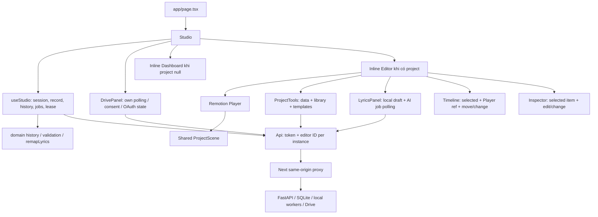

# UI Gap Analysis — Dashboard & Professional Editor

**Trạng thái:** khảo sát mã + đề xuất, chưa triển khai

**Ngày:** 24/11/2026 (Asia/Saigon) · **Baseline:** `dev`, `ba60ab0`

**Thẩm quyền:** UI-01 Proposed; [UI-02 nguyên văn](UI_02_VIDEO_EDITOR.md) Approved for Design — Not Implemented. Bản đầy đủ UI-02 đã được PO bổ sung trong phiên khảo sát.

## 1. Phương pháp và phạm vi

Chỉ đọc repository và viết bốn tài liệu `docs/ui-ux/`. Không sửa application code, API, DB hoặc tests; không chạy application/browser test trong lượt khảo sát này. “Có trong mã” không đồng nghĩa đạt nghiệm thu. Các kết quả S6 ở [báo cáo cũ](../planning/S2_S6_RESULTS.md) là evidence lịch sử, không phải kết quả kiểm redesign hôm nay.

Nguồn đã đối chiếu:

- `AGENTS.md`, `apps/web/AGENTS.md`; PRD/SRS/RTM và OPEN_QUESTIONS tại **root**. Đường dẫn `docs/requirements/*`/`docs/decisions/OPEN_QUESTIONS.md` trong AGENTS chưa khớp vị trí thật; không di chuyển file.
- [ADR-0001](../decisions/ADR-0001-LOCAL_MVP_ARCHITECTURE.md), [ADR-0002](../decisions/ADR-0002-DIRECT_GOOGLE_DRIVE.md), [contracts](../architecture/MVP_CONTRACTS.md). Dùng ADR-0002 cho Drive trực tiếp thay vì mô tả desktop-sync cũ trong SRS.
- Toàn bộ frontend ứng dụng: `app/{page,layout}.tsx`, `app/globals.css`, API proxy `[...path]/route.ts`, `next.config.ts`, `lib/api.ts`, `hooks/use-studio.ts`, sáu component `studio`, `timeline`, `inspector`, `project-tools`, `lyrics-panel`, `drive-panel`.
- Shared `packages/domain` (schema/types/history/editing/lyrics), `packages/composition/src/scene.tsx`; backend `amvs/app.py`, `edit_leases.py`, `store.py`, catalog/snapshot/jobs và Drive status/backup/restore boundary liên quan.
- Tests unit/domain, integration local-api/MVP/Drive/launcher và bảy file browser specs; fixture server, Playwright config và runners S6 để xác định vùng coverage/điểm coupling. Không dùng đọc test làm bằng chứng test pass.

## 2. Cấu trúc hiện tại và dependency

- Global sidebar bên trái là **điều hướng project**, không phải Left Tool Panel. `.editor-layout` chỉ có preview/tools/timeline + inspector (hai cột).
- `Studio` giữ JSX Dashboard, editor và preset-rescale handlers. `useStudio` sở hữu history, `record.revision`, serial working-save queue, Player ref, jobs và lease; component con gọi `change/prepare/reload` nhưng cũng có direct API actions.
- `ProjectTools` gộp recovery/package/delete, local storage/quota/GC, library/tags/suggestions và personal templates; các `
` dài nằm trong `.editor-main` trước Lyrics/Timeline.
- `LyricsPanel` có `lines/input/audioId/model/language/job` state riêng. Remount khi đổi mode/tab có thể làm mất draft chưa lưu; polling/restore job cần sống ngoài tab content.
- Inspector đã có nhánh theo `item.type`, nhưng luôn lẫn project/name/duration/preset; Music Card metadata hiện theo template, chưa là inspector riêng.
- Timeline select/move/track order/add text gọi controller. Frame đọc từ Player bằng timer 100ms; trim chủ yếu bằng numeric Inspector, chưa có trim handles.
- DrivePanel mount thường trực phía trên cả Dashboard và Editor, polling 2s kể cả khi đóng form; restore xong chưa gọi `refresh` danh sách project của useStudio.
- CSS `min-height:100vh`, preview 470px/420px, không viewport grid/resize handle; một số danh sách có overflow riêng nhưng toàn Editor vẫn có nội dung dài.

## 3. Quy ước phân loại

**Đã hỗ trợ trong code** = có đường đi hiện hữu. **Hỗ trợ một phần** = có nền/chức năng nhưng chưa đủ UX mới. **Chưa triển khai** = chưa có cấu trúc/capability tương ứng. **Có dấu hiệu lỗi** = thấy nhánh mã rủi ro; phải tách khỏi nguyên nhân đã được chứng minh. **Cần kiểm chứng trên trình duyệt** = chưa có quan sát hiện tại; có thể đi kèm một trong bốn trạng thái trên.

### UI-01

| Yêu cầu | Phân loại | Bằng chứng / khoảng cách | Xử lý đề xuất |
|---|---|---|---|
| Hòa Âm, dark-purple | Đã hỗ trợ trong code | `studio.tsx` brand, `globals.css` tokens accent/panel | Giữ nhận diện, chuẩn hóa tokens |
| Creative Dashboard thay landing | Hỗ trợ một phần | Nhánh Dashboard còn hero/marketing text, không dashboard project content | Tách DashboardWorkspace |
| Hero gọn, ba template vùng nhìn đầu | Hỗ trợ một phần; cần kiểm chứng trên trình duyệt | Ba CTA tạo draft thật; padding 70px, h1 tới 60px, template margin-top 50px | Wireframe ở hai viewport, đo bounds |
| Recent projects | Hỗ trợ một phần | Sidebar có list; API `{id,name}` theo rowid, không last-opened | D-01: định nghĩa recent trước thiết kế chi tiết |
| Sidebar/điều hướng | Có dấu hiệu lỗi; hỗ trợ một phần | “Studio của tôi” không handler; brand anchor không có navigation action | Navigation qua controller/dirty guard |
| Drive khỏi Dashboard chính | Chưa triển khai | DrivePanel render trước nhánh Dashboard | Entry Lưu trữ mở manager riêng |

### UI-02 — đối chiếu đầy đủ nhóm yêu cầu

| Mục đặc tả | Phân loại | Hiện trạng / khoảng cách cụ thể | Owner giai đoạn |
|---|---|---|---|
| §1–2 dark-first/design tokens | Hỗ trợ một phần | Có palette/type cơ bản; CSS global `main/footer/h1/button`, chưa thống nhất modal/tooltip/tab/toast/semantic states | R1 |
| §3 ba cột | Chưa triển khai | Global nav không thay Left Tool Panel; editor grid hai cột | R3 |
| §3 no page scroll/independent panels | Hỗ trợ một phần; cần kiểm chứng trên trình duyệt | Chỉ lyrics/library có max-height overflow; không `100dvh` shell, min-height 0 chain | R3 |
| §3 Preview/Timeline luôn hiện | Chưa triển khai theo yêu cầu mới | Tools và lyrics chèn giữa preview/timeline; dưới 850px Inspector xếp xuống dưới | R3 |
| §4 Header/back/project/save | Hỗ trợ một phần | Save/export/dirty có; back Dashboard chưa có, undo ở editor toolbar, save pending/error chỉ message/busy chung | R1/R2/R3 |
| §5 lease/read-only/takeover | Hỗ trợ một phần; có dấu hiệu lỗi; cần kiểm chứng trên trình duyệt | Có claim/5s heartbeat/30s expiry/release/takeover + revision. Chưa kết luận root cause; xem §4 | R0/R2 |
| §6 năm tabs Left Panel | Chưa triển khai | Chưa có tool tabs; nhiều details trong main | R3/R4 |
| §6.1 import/search/tag/reuse | Đã hỗ trợ trong code cho luồng hiện tại | Multiple upload + partial errors, library search/tag/reuse/audio listen; placement chưa đúng | R4 |
| §6.1 type filter/format/video preview | Hỗ trợ một phần | Có kind/duration/mime trong asset DTO; chưa có filter/format label và video player trong library | R4 |
| §6.1 thumbnail fallback/retry/long names | Hỗ trợ một phần | lazy thumbnail, wrapping CSS; chưa onError/retry UI | R4 |
| §6.1 media drag/drop | Chưa triển khai | Không thấy media drag/drop từ library; chỉ có clip reposition timeline | R4, chỉ sau kiểm chứng |
| §6.2 Text tools | Hỗ trợ một phần | Add text ở Timeline, chọn clip và style ở Inspector; chưa text tab/preset browser | R4 |
| §6.3 Effects/Templates | Hỗ trợ một phần | Các animation enum dùng được; personal template typed slots/instances có. Chưa browser preset nhóm/live effect preview | R4 |
| §7 composition/ratio/Play-Pause | Đã hỗ trợ trong code cho nền hiện tại | Shared Player/Scene, dimensions/FPS theo project, Play/Pause thật | Giữ R3/R4 |
| §7 preview controls/safe area | Hỗ trợ một phần | Seek ở ruler; thiếu scrubber/timecode/mute-volume/fullscreen riêng và safe-area overlay | R3/R4; fullscreen policy D-05 |
| §8 contextual Inspector | Hỗ trợ một phần | Có type branches; project/preset/Music Card trộn chung; chưa clear selection dễ dùng | R4 |
| §8 image/video transforms | Hỗ trợ một phần / capability chưa triển khai | fit/crop position/blur/brightness có; schema/scene không có arbitrary zoom/rotation/general transform/filter presets | R0 capability decision D-02; R4 chỉ field hiện hữu |
| §8 audio/video speed | Hỗ trợ một phần | Rational `speed` và playbackRate renderer có; Inspector chưa có input speed. Audio volume=0 có thể mute; chưa toggle riêng | R4, giữ mapping/validation |
| §8 Text/Lyrics typography | Hỗ trợ một phần | Fonts 2 loại, size/color/stroke/shadow/x/y/animation có; rotation chưa contract; highlightColor có schema/scene nhưng chưa control | R4 |
| §8 Music Card | Hỗ trợ một phần | Metadata role/title/artist, cover theo ảnh thứ hai, typography có; layout/progress style là giá trị scene cố định | D-02; không dựng field giả |
| §8 numeric/slider/reset/disabled reason | Hỗ trợ một phần | Nhiều numeric, audio range, fieldset read-only; chưa paired controls/reset/reason nhất quán | R1/R4 |
| §9 dock/resize | Chưa triển khai | Timeline trong document flow; chưa separator/resize/reset/persist size | R3 |
| §9 select/reposition/seek/zoom/order/undo | Đã hỗ trợ trong code cho nền hiện tại | Pointer-up commit move, zoom 1–8, track order; trim ở Inspector | Giữ R3/R4, browser regression |
| §9 trim handles/split/duplicate/snapping/visibility | Hỗ trợ một phần / chưa triển khai | Numeric trim có; các thao tác advanced chưa có. Spec cho split/duplicate/snapping/visibility theo capability; không tự mở Complete | R0 D-02 |
| §10 Recognition | Hỗ trợ một phần | Audio/model/language/start/cancel/import/draft/job reopen có; chưa mode riêng, quyền UI chưa thống nhất | R2/R4 |
| §10 Editing/Alignment | Hỗ trợ một phần | Sentence edits/review/apply, align job/fallback có; chưa source audition/word detail UI | R4 |
| §10 Styling/Draft-Reviewed-Applied | Hỗ trợ một phần | Style nằm Inspector, words highlight trong Scene; Applied suy ra lyric items, không enum trong schema | R4; không thêm enum persisted |
| §11 Storage workspace | Chưa triển khai về layout; nền Drive đã có | OAuth/config/folder/backup/auto/restore/exports có trong panel inline | R5 |
| §11 last backup/history | Hỗ trợ một phần | `lastBackup` có backend, chưa trong frontend DriveState; `GET drive/backups` có list, chưa manager history UI | R5, dùng field hiện hữu |
| §11 progress/errors/cancel | Hỗ trợ một phần; thiếu capability | Backend message theo file/phase; không byte-% contract, không cancel backup/restore endpoint; async failure message gộp network/permission/quota | D-03, không tự đổi API |
| §11 consent/safety | Đã hỗ trợ trong code cho các đường hiện tại; cần browser regression | Explicit backup consent, auto default off ở cấu hình mới; snapshot/checksum/no overwrite/no local delete | R5/R6 giữ đầy đủ |
| §12 Export workspace | Chưa triển khai về layout; nghiệp vụ hỗ trợ một phần | Preset trong Inspector, toolbar gọi picker + jobs, kết quả cuối trang | R5 |
| §12 resource preflight/wait/cancel/retry/output | Hỗ trợ một phần | Missing media endpoint; job admission/disk/validation ở backend. Chưa resource-preflight DTO riêng; không hứa trước queued là đủ RAM | R5, hiển thị status/message backend |
| §13 global states | Hỗ trợ một phần | Inline status/alert + busy/dirty/missing/read-only; chưa state taxonomy/toast/retry/error boundaries thống nhất | R1/R2/R5 |
| §14 UI-ED-01…15 | Cần kiểm chứng trên trình duyệt | Suite cũ có một phần flows; chưa assert geometry/resize/keyboard mới | R0 baseline và R6 |
| §15–16 scope/governance | Đã xác định ràng buộc | Không đổi engine/schema/codec/API/DB, không mockup thay chức năng, chỉ tài liệu lúc này | Mọi R |

## 4. Lease: dữ kiện, giả thuyết và cách chứng minh

**Chưa xác nhận nguyên nhân lỗi chỉ đọc/takeover của người dùng.** Các điểm sau là quan sát mã và kịch bản cần tái hiện, không phải chẩn đoán runtime đã hoàn tất.

| ID | Dữ kiện đọc được | Tác động có thể xảy ra / kiểm cần làm |
|---|---|---|
| L-01 | `adopt()` đặt writable=false rồi claim; takeover POST → set true → GET → adopt → claim thêm | Cửa sổ pending và response đến sai thứ tự; cần trace thứ tự request, project ID + generation + editor ID đã che/mã hóa |
| L-02 | Nút takeover gọi `.catch(() => {})`; hàm takeover không tự set error, canWrite=false không có nhánh feedback | Có nhánh lỗi bị nuốt ở UI. Đây là thiếu feedback nhìn thấy từ mã, không chứng minh nguyên nhân permission failure |
| L-03 | Heartbeat chỉ chạy khi `writeRef.current` true; heartbeat error chỉ set message | Read-only không tự biết owner đã đóng; network/expiry có thể để UI vẫn bật trước khi server từ chối. Kiểm TTL/close/background tabs |
| L-04 | Request adopt chỉ kiểm project ID, không generation; queued sync dùng record hiện tại theo ID | A→B→A hoặc load/takeover nhanh cùng ID có thể áp response cũ; cần delayed-response tests trước kết luận |
| L-05 | Release trong effect cleanup + beforeunload, không xác nhận unload thật xảy ra; đang dùng keepalive | Hủy đóng tab/StrictMode/remount có thể đổi lifecycle. Tái hiện cả dev StrictMode và production, không bỏ release bảo vệ |
| L-06 | `Api` tạo editor UUID mỗi instance, token bootstrap riêng; error wrapper chỉ giữ message, bỏ status/code | Remount controller có thể tạo phiên mới; khó phân biệt SESSION/Conflict/DRIVE. Kiểm stable Api identity; giữ HTTP code trong client không đổi DTO |
| L-07 | Inspector/Timeline nhận editable; ProjectTools/LyricsPanel không nhận quyền chung, một số API direct | Project mutation thường bị `change`/server chặn nhưng affordance lệch; phân biệt catalog/global actions với project writes, không disable toàn bộ read actions |
| L-08 | Backend guard chặn khi có lease sai owner/hết hạn; **không có row thì guard cho qua**. PATCH có optimistic revision; save kiểm guard trong worker | Không phải hệ exclusive lease bắt buộc cho mọi write ở mọi endpoint. Nếu cần siết semantics backend phải có reproduction/đề xuất riêng; không tự đổi trong redesign |
| L-09 | Một số job/template/package endpoint dùng revision, không lease.guard | Quyền khởi job khác quyền sửa project. Giữ policy hiện tại, xác định UI permissions rõ trước thay đổi; không quảng cáo mọi endpoint fenced |

Thu thập tối thiểu: dev/production, một/hai tab, TTL, suspended/resumed, đóng thường/kill owned test browser, reload launcher, 401/409/timeout, click takeover nhiều lần, request đảo thứ tự, dirty before takeover, Manual Save đang chờ worker. Không log token, OAuth JSON, media contents hay raw project text. Dùng disposable workspace, không tự kill launcher đang chứa dữ liệu người dùng.

## 5. Capability/contract gaps cần quyết định

1. **D-01 Recent:** không có last-opened timestamp. Chọn semantics trong phiên hoặc duyệt yêu cầu dữ liệu riêng.
2. **D-02 Inspector/Timeline advanced:** UI-02 được giữ nguyên; zoom/rotation/card layout/progress style không thể chỉ đổi CSS UI để xuất MP4 đúng. Không tự thêm schema/renderer. Cần PO quyết định task mở rộng riêng hoặc chấp nhận còn gap ở phạm vi redesign hiện tại. Không tự đánh mục này hoàn thành.
3. **D-03 Drive:** không có structured async error categories/byte-progress/cancel transfer. UI chỉ được hiển thị dữ liệu thật đang có. Distinct quota vs permission và nút cancel transfer cần quyết định contract riêng; hủy OAuth hiện có không tương đương hủy upload.
4. **D-04 UI persistence:** `view.panels` hiện boolean keys whitelist; schema content không có timelineHeight/activeTool/lyricsMode. Đề xuất giữ UI mới trong session memory trước; không lén đưa vào content/DB/localStorage. Nếu cần persistence qua restart, phải duyệt mapping/version tương thích.
5. **D-05 Small viewport/fullscreen:** phải duyệt compact layout và ngoại lệ fullscreen do người dùng chủ động. Fullscreen một mình preview không đồng thời hiện timeline; không tự coi đó là đáp ứng literal “luôn hiển thị”.
6. **D-06 Asset DTO:** MIME/kind/duration có trong `/assets`; Asset TS hiện không khai báo bytes/width/height dù server có thể trả. Nếu cần metadata thêm thì đọc field thực đã có, không phát minh endpoint. Về safe area, chỉ UI overlay, không tham gia composition/export.

## 6. Coverage hiện có và phần thiếu

| Nguồn test | Đã có assertion trong mã | Thiếu đối với redesign |
|---|---|---|
| `tpl01`, `multi-media`, `music-card` E2E | Import thật, edit/reorder/trim/undo, manual save/reopen, MP4/job | Entry navigation/DOM selectors mới, viewport no-scroll, dialog export |
| `core-workflows` E2E | Lyrics import/review/style/preset/recovery/package; template; labelled AI transport; 12/100 clips; hai tab takeover | Draft survive mode switch; takeover failure/expiry/close/launcher/manual-save-undo-after-takeover; panel geometry |
| `drive-settings` E2E | Config/cancel OAuth **local**, bootstrap origin restrictions | Storage dialog/focus, last backup/history, restore refresh; không phải Google thật |
| `fidelity`, `long-run` E2E + scripts | Opt-in screenshot-vs-MP4, 300s snapshot/dirty/resource | Rerun theo ảnh hưởng code; không dùng screenshot layout thay độc lập decode |
| `test_local_api`, `test_mvp_completion` | Optimistic conflict/manual hash/race, recovery/package/pins, lease/expiry, queued-save takeover | Kịch bản browser lifecycle và state machine mới |
| `test_drive`, launcher tests | Consent/OAuth/checksum/no overwrite/fault/owned tree | UI focus/semantics; không thay browser/cloud test |
| Unit `domain/editing/music-card/lyrics` | Hash/schema/history, template independence/source mapping | Pure UI reducer/resize math nếu thêm sau duyệt |

Playwright hiện mặc định 1440×1000, 1 worker; nhiều selector dựa `.navigation .current-project`, `.ruler`, `.clip`, labels/summary cũ. Các test này cần di chuyển entry/selector có chủ đích; giữ assertion nghiệp vụ, không xóa test để xanh. R0 ghi artifact baseline mới; R6 phải có 1366×768 và 1920×1080. Lượt khảo sát này **không chạy lại** các suite trên, không có pass mới cho UI-ED.

## 7. Lưu ý hồ sơ

Một số dòng RTM còn nói inference/output bị RAM chặn, và báo cáo implementation cũ nói chưa push, trong khi checkpoint `ba60ab0` và evidence S6 mới hơn đã có. Không dùng dòng cũ làm kết luận hiện tại, không nâng Verified từ số test. Trong nhiệm vụ này chỉ ghi discrepancy ở đây; không sửa RTM/ADR hoặc các quyết định đã chốt.
