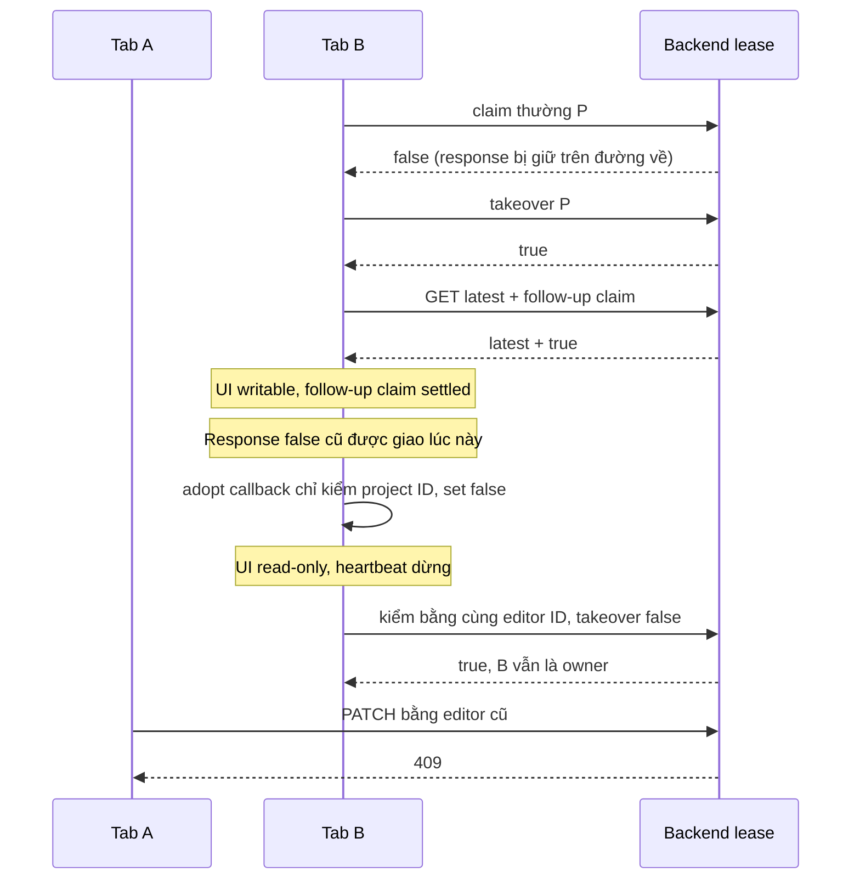

# R0 — Editor Lease Diagnosis

**Cập nhật implementation R0:** PO đã cho phép sửa riêng Editor Lease/read-only; đã triển khai, chạy regression và kiểm lại C06. Sẵn sàng review chức năng R0 lease với giới hạn timing/native picker; xem [kết quả triển khai và evidence](UI_R0_LEASE_FIX_RESULTS.md). Các mô tả “chưa sửa” bên dưới là baseline/chẩn đoán lịch sử; R1–R6 và UI redesign chưa triển khai.

**Ngày:** 24/11/2026 (Asia/Saigon)

**Trạng thái:** đã tái hiện và xác định nguyên nhân các kịch bản bên dưới; chưa sửa application code

**Git:** `dev`, HEAD `5df631e`; application code kế thừa `ba60ab0`; có cập nhật tài liệu D-01…D-06 chưa commit từ trước lượt này.

## 1. Phạm vi và cách chạy

Đã đọc đủ bốn tài liệu UI/UX: UI-01, UI-02 nguyên văn, Gap Analysis và Redesign Plan, gồm các cập nhật D-01…D-06. Chỉ thực hiện phần R0 baseline/lease diagnosis được PO giao; không tự bắt đầu R1/R2, không chốt wireframe UI-01 hoặc public API delta trong lượt này.

Hai công cụ chẩn đoán mới:

- `scripts/diagnose_editor_lease.mjs`: browser flows, quan sát request/response đã lọc, screenshot và assertions về tình trạng hiện tại.
- `scripts/diagnose_editor_lease_server.py`: tạo bản nguồn/build dùng thử và giám sát riêng service processes bằng Windows Job Object.

Không sửa `use-studio`, `Api`, `EditLeases`, API handlers, project schema, DB schema, renderer hoặc tests cũ. Không xóa lease/ép canWrite/bỏ guard. Heartbeat **5s**, TTL backend **30s** giữ nguyên. Không chạy render/AI/Drive upload để chẩn đoán lease.

Isolation:

- Chép tracked sources/config và production build đang có sang `.local/evidence/ui-r0/<run>/source`; không chép `.env`, workspace người dùng hoặc credentials. Node dependencies dùng junction tới dependency đã cài, không tải/cài mới.
- Production chạy Next `start` với build được chép và FastAPI thật trong fixture workspace riêng. Chỉ native folder chooser được thay bằng grant thử có sẵn khi kiểm Manual Save; lease/revision/save endpoint là thật.
- Development chạy bản sao **không sửa** của `scripts/dev.py --no-browser --restart`; API/database/session cũng riêng. Không restart/kill launcher gốc của người dùng.
- Chromium headless là browser đã cài. Trace chỉ giữ method/path/status/canWrite/revision và editor ID đã SHA-256 rút gọn; không ghi bearer/session token, OAuth config hoặc nội dung project vào network artifact. Không tạo HAR/Playwright trace chứa nguyên headers.
- So sánh SHA-256 **51 file application/domain/backend** với source inventory cho mỗi run: không có file gốc thay đổi. Các file generated của Next có thể đổi **trong bản sao**.

## 2. Evidence thực tế

| Run | Nội dung | Kết quả công cụ |
|---|---|---|
| `1795493626938273700` | 19 scenario executions, production + development; controls, lỗi có kiểm soát, layout, TTL và launcher restart | 19 `observed`, 0 `probe-failed`; không có nghĩa UI-ED đã pass |
| `1795494189506477200` | Chạy lại riêng C03 với điều kiện chặt hơn: chờ follow-up claim mới hoàn tất, giao response cũ sau đó, quan sát thêm 6s | 3/3 production + 3/3 development tái hiện trạng thái sai kéo dài |

Raw artifacts tại `.local/evidence/ui-r0/<run>/`: `r0-results.json`, `redacted-network.json`, `source-inventory.json`, `source-and-trace-check.json`, snapshots của harness và screenshots dưới `production/`, `development/`. Git-ignored; không coi raw artifacts đã được push.

Lượt đầu C03 quan sát được chuyển sang disabled nhưng chưa ràng buộc toàn bộ follow-up claim đã settled. Không dùng riêng quan sát tức thời đó để kết luận kẹt lâu. Lượt thứ hai bổ sung barrier và kiểm sau 6s; đó là evidence quyết định cho root cause C03. Giữ nguyên kết quả thô cả hai lượt.

C01 của raw lượt đầu có field `specificationViolation:false` cho **luồng lease control**, không phải pass layout. Geometry bên trong chứng minh layout hiện tại vi phạm UI-ED-01/02; bảng §6 phân biệt rõ. Harness bàn giao đã tách thành `leaseSpecificationViolation` và `layoutViolations` để tránh hiểu sai.

## 3. Nguyên nhân chính được xác nhận — C03

**Response claim cũ cho cùng project có thể ghi đè quyền từ lượt takeover mới hơn.**

Chuỗi tái hiện:

1. Tab A mở project P, nhận quyền ghi từ backend thật.
2. Tab B mở P. Request claim thường của B (`takeover:false`) được backend trả `canWrite:false`; harness chỉ giữ lại response, không đổi body/header hoặc logic lease.
3. Trong khi response cũ còn trên đường về, người dùng bấm “Nhận quyền chỉnh sửa” ở B. POST `takeover:true` thật thành công.
4. B tải project mới nhất, `adopt()` chạy và follow-up claim thường của B nhận `canWrite:true`. Harness đợi request này hoàn tất và UI enabled qua double-rAF.
5. Harness giao lại response cũ `canWrite:false`. UI B chuyển về read-only và vẫn read-only sau 6s, vượt một chu kỳ heartbeat.
6. Request kiểm chứng backend bằng **cùng editor ID B**, `takeover:false`, vẫn trả `canWrite:true`. PATCH từ editor ID A bị **HTTP409**. Backend ownership đã đúng, frontend state đã sai.

**Vị trí và chuỗi nhân quả:**

- `apps/web/hooks/use-studio.ts:53–71`: callback claim trong `adopt` chỉ kiểm `latest.current?.id === value.project.id`; không có generation/request-order fence. Response cũ cho P vẫn hợp lệ theo điều kiện này sau một takeover mới cũng của P.
- `use-studio.ts:588–606`: takeover POST → set writable sớm → GET → adopt/claim thêm, tạo nhiều lượt async có khả năng hoàn thành khác thứ tự.
- `use-studio.ts:311–339`: heartbeat chỉ chạy khi `writeRef.current` true. Sau response cũ đặt false, UI không còn heartbeat để tự phát hiện backend đang cho chính B ghi.



**Mức chắc chắn:** nguyên nhân đã được chứng minh cho race có độ trễ/đảo thứ tự trên, 6 lần kiểm chặt. Không khẳng định mọi lần read-only mà người dùng từng gặp đều có cùng chuỗi request; chưa có network log của phiên người dùng đó. C03 không cần giả response canWrite, không cần làm hỏng backend, không cần bỏ lease và không chỉ xảy ra ở dev/StrictMode.

## 4. Các nguyên nhân phụ đã tái hiện

| Case | Điều kiện | Quan sát thật | Nguyên nhân mã |
|---|---|---|---|
| C04 | Gây HTTP503 có nhãn cho takeover; owner A vẫn tồn tại | B vẫn readonly, footer không đổi, không thấy thông báo lỗi; A vẫn là owner | `studio.tsx:195` gọi `takeOver().catch(() => {})`; takeOver không tự hiện lỗi |
| C05 | Takeover thật thành công; GET latest của B bị ngắt mạng; server đã có revision mới hơn snapshot B | B enabled dù đang giữ dữ liệu cũ; edit gây PATCH409, content server được giữ nguyên | `use-studio.ts:603–605` enable trước GET/adopt; lỗi GET bị callback UI nuốt |
| C06 | Ngắt heartbeat sau claim thành công, chờ **32s thật**, không rút TTL | UI vẫn enabled; backend từ chối PATCH409 vì lease hết hạn; 6 heartbeat thất bại được quan sát | Heartbeat catch chỉ set message, không chuyển quyền sang trạng thái uncertain/read-only |

Mỗi case trên được quan sát ở cả production và development. Đây là **fault injection/network-loss tests có ghi nhãn**, không phải chứng minh service tự phát trả 503 hoặc mạng thực đã lỗi trước đây. Không tạo mất dữ liệu server trong C05/C06; optimistic concurrency/lease vẫn làm nhiệm vụ chặn ghi.

## 5. Các luồng control đã kiểm

| Case | Production | Development | Giới hạn |
|---|---|---|---|
| C01 một tab mới | Nhận quyền ghi | Nhận quyền ghi | Không thấy lỗi readonly tự phát trong control này |
| C02 hai tab, takeover thường | B writable, A readonly, A PATCH409; edit/Undo/Redo và Manual Save thành công | B writable, A readonly, A PATCH409; edit/Undo/Redo hoạt động | Manual Save development **chưa chạy** vì launcher thật không có native grant fixture; không suy thành pass |
| C07 owner đóng và mất release | Sau TTL thật, explicit takeover thành công | Tương tự | Không yêu cầu read-only tab tự chiếm lease; giữ phân biệt recovery thủ công với collaboration |
| C08 restart launcher dùng thử | Không áp dụng | Khởi lại copied launcher, mở project cùng hash, claim writable; session token cũ bị401 | Supervisor dừng owned tree rồi chạy lại copied launcher với `--restart`; không thử trên launcher gốc của user |

Integration đã chạy trong lượt R0:

```powershell
./.venv-api/Scripts/python.exe -m pytest tests/integration/test_mvp_completion.py tests/integration/test_local_api.py -k 'editor_lease or queued_manual_save or revision_dirty' -q
```

**3 passed, 44 deselected**, một Starlette/httpx deprecation warning. Chứng minh thêm guard/revision/manual-save race hiện hữu hoạt động trong các test được chọn; không phải full regression 63 test hoặc bằng chứng đã sửa UI.

## 6. Baseline layout R0

C01 dùng project default TPL-01, các details đóng, không có media cá nhân. Kết quả đồng nhất ở production và development:

| Viewport | Document height | Preview top/bottom | Timeline top/bottom | Inspector bottom |
|---|---|---|---|---|
| 1366×768 | 1703px | 198/668px | 1062/1378px | 1658px |
| 1920×1080 | 1703px | 198/668px | 1062/1378px | 1658px |

Ở 1366×768 Timeline hoàn toàn dưới fold; 1920×1080 chỉ thấy mép đầu Timeline. UI-ED-01 (no-page-scroll) và UI-ED-02 (hiển thị đồng thời đầy đủ) **chưa đạt ở baseline này**. Không thực hiện resize/tabs mới vì chưa triển khai R3; screenshot không chứng minh acceptance mới.

## 7. Những giả thuyết chưa được chứng minh

- A→B→A với nhiều project; queue sync cũ; cancelled beforeunload; duplicate release do StrictMode: còn cần test riêng nếu R2 chạm lifecycle tương ứng. Không coi C03 tự động chứng minh tất cả L-01…L-09.
- `Api` mất status/code là quan sát mã, chưa chứng minh nó là root cause của C03; lỗi nhận quyền của phiên người dùng cụ thể chưa có trace.
- Guard khi chưa có lease row và quyền job/catalog ngoài project mutation vẫn như baseline. Không tuyên bố mọi endpoint fenced; không sửa policy server trong R0.
- Chưa kiểm toàn bộ loại clip, model quality, render fidelity, Drive transfer hoặc performance. Không chạy AI/render/Drive để né phạm vi chẩn đoán.
- UI-01 wireframe và technical contracts D-01…D-06 vẫn chưa được chốt đầy đủ; hoàn tất lease diagnosis không phải đóng toàn bộ R0/design acceptance.

## 8. Hướng sửa R2 đề xuất — chưa triển khai

1. Thêm generation/request fence theo project + lượt ownership. Khi bắt đầu takeover/load mới phải invalidate response claim cũ, kể cả cùng project ID. Chỉ state machine của lượt hiện hành được commit quyền.
2. Điều phối takeover → load latest → xác nhận quyền của lượt hiện hành; chưa bật editor trước khi record/revision/lease tương ứng đã sẵn sàng. Không replay draft cũ với revision mới hoặc last-write-wins.
3. Hiển thị lỗi takeover/reload, kể cả canWrite=false; giữ draft an toàn và cho retry/reload có kiểm soát. Bỏ nhánh nuốt lỗi của UI action, không bỏ guard.
4. Heartbeat/network failure chuyển uncertain, tạm chặn ghi, kiểm lại quyền/revision khi phục hồi. Không gửi takeover:true ngầm để tự chiếm quyền.
5. Giữ API session header, editor identity, server lease/TTL/guard và optimistic revision. Chỉ sửa backend nếu có bằng chứng độc lập yêu cầu; các case R0 hiện tại không cần bypass server để chữa UI.

Test hồi quy sau bản sửa phải kiểm **UI vẫn writable khi response denial cũ đến**, takeover error hiện rõ, failed reload không enable stale editor, expired lease không còn affordance ghi, và stale tab vẫn bị server chặn. Harness hiện tại chẩn đoán **bug đang tồn tại**, không phải suite nghiệm thu bản sửa.

## 9. Tái lập và kiểm tra công cụ

Từ root, môi trường/dependencies/browser đã setup và có production build:

```powershell
# Tự tạo source/build copy + workspace riêng và chạy hai modes.
node scripts/diagnose_editor_lease.mjs

# Chỉ kiểm race, vẫn chạy 3 repetitions mỗi mode và chờ TTL/lease nguyên trạng.
$env:AMVS_R0_CASE_FILTER='C03'
node scripts/diagnose_editor_lease.mjs
Remove-Item Env:AMVS_R0_CASE_FILTER
```

Lượt đầu dùng preparer tạm `.local/prepare_ui_r0.py` và đường dẫn prepared-run truyền vào Node; preparer đã được đưa vào `diagnose_editor_lease_server.py --prepare` cho lần bàn giao. Lượt kiểm chặt đã dùng entry tự chuẩn bị ở trên. Copy harness đúng lúc chạy được lưu trong từng evidence folder để phân biệt trước/sau formatting và bổ sung barrier.

`diagnosticStatus:observed` / exit0 nghĩa là assertions chẩn đoán đạt và tái hiện tình trạng đã mô tả, **không có nghĩa bug đã được sửa hoặc UI-ED-05 pass**. Lượt lỗi của chính probe phải là `probe-failed`/exit2. Token/editor capabilities không được in hoặc đưa lên Git. Chạy xong đóng các owned service/browser; không kill Node/Python toàn máy.

Syntax Node, Ruff của supervisor và Prettier của harness đã kiểm. Các checked scripts là công cụ R0, không phải thay đổi ứng dụng. Chưa commit/push; UI-02 nguyên văn không đổi.
